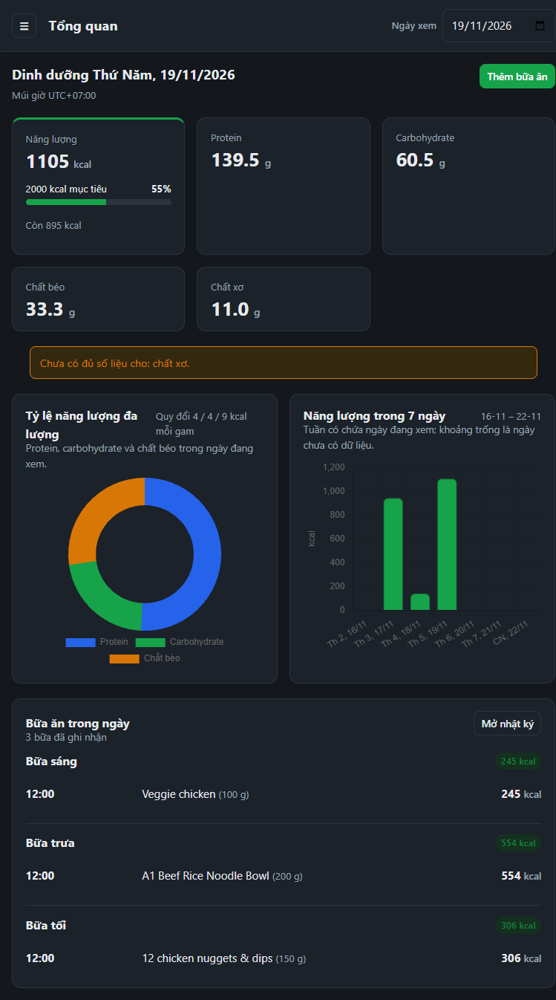
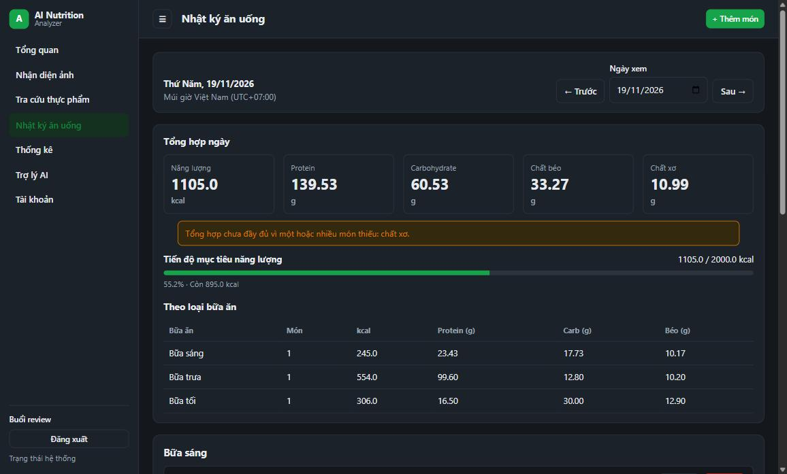
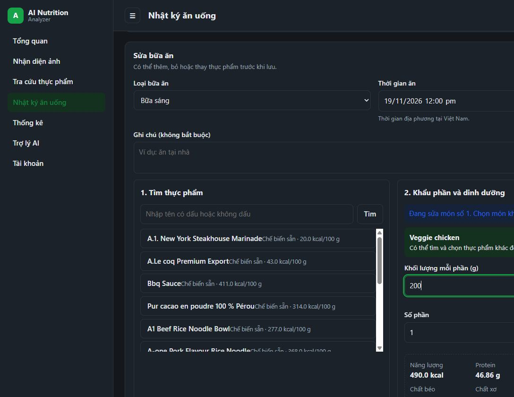
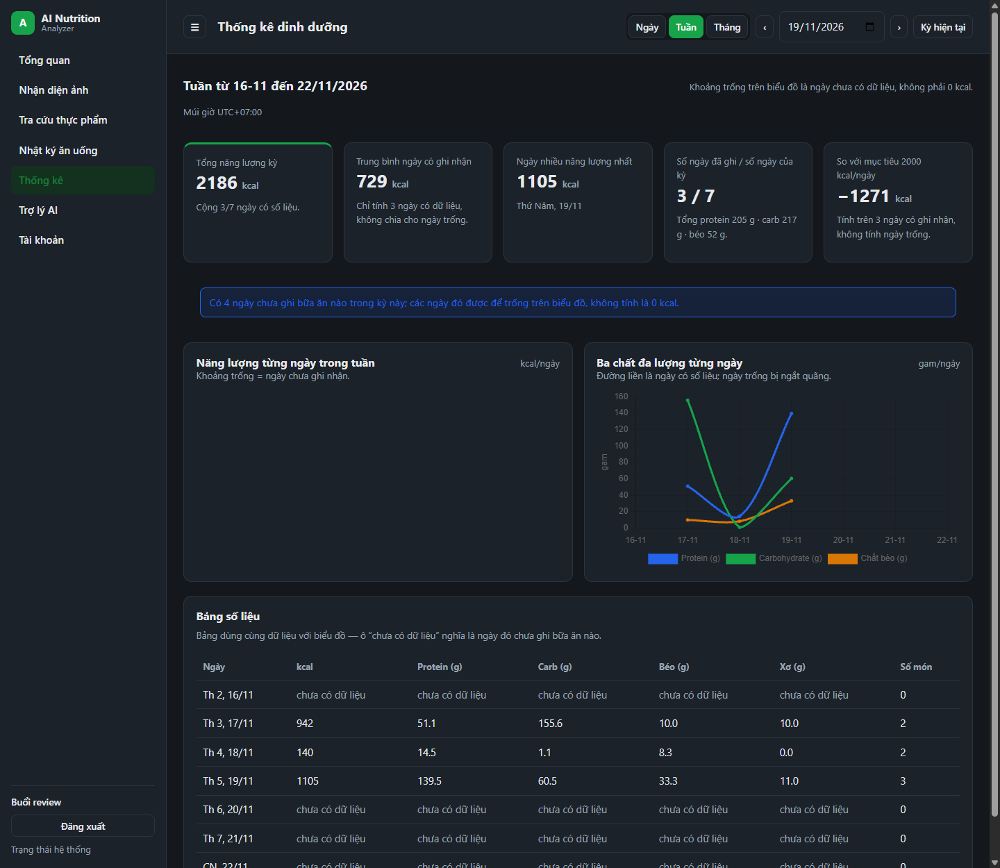
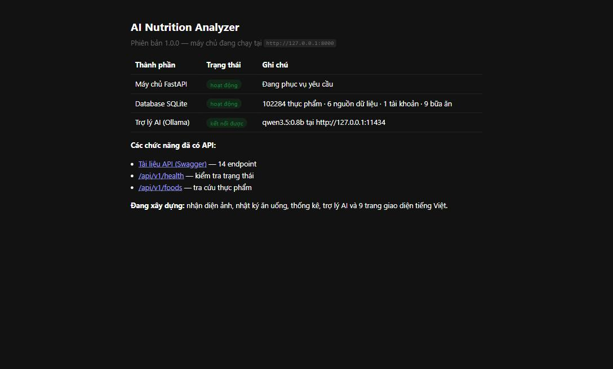

# BÁO CÁO KIỂM THỬ TOÀN WEBSITE — AI NUTRITION ANALYZER

Thời điểm: 19/11/2026, khoảng 05:20–05:30 (giờ Việt Nam); **chạy lại toàn bộ lúc 27/11/2026 00:30:08 (giờ Việt Nam), sau khi thay model nhận diện ảnh từ 15 lớp lên 24 lớp** · Máy chủ: `http://127.0.0.1:8000`
Ứng dụng chạy bằng: `.venv\Scripts\python.exe` (Python 3.12.8) · FastAPI 0.165.0 · SQLAlchemy 2.1.9 · scikit-learn 1.9.1 · torch 2.15.0+cpu · pytest 9.2.0

**Kết luận ngắn:** website đã đủ **9/9 trang**, mọi chức năng chính đã được kiểm thử trên hệ thống đang chạy thật.
**92/92 bài kiểm thử chức năng đạt**, **168 bài kiểm thử đơn vị/tích hợp đạt** (1 bài bỏ qua vì cần bật cờ gọi Qwen thật).
Trong quá trình kiểm thử đã tìm và sửa **10 lỗi thật** (chi tiết ở §5), trong đó có một lỗi khiến chức năng ước lượng calo bằng model **không bao giờ chạy được**.

---

## 1. Cách chạy lại (đã chạy đúng như vậy)

```bat
:: 1. Bật website
START_WEBSITE.bat

:: 2. Kiểm thử đơn vị + tích hợp (không cần máy chủ đang chạy)
.venv\Scripts\python.exe -m pytest

:: 3. Kiểm thử chức năng toàn hệ thống qua API thật (CẦN máy chủ đang chạy)
.venv\Scripts\python.exe scripts\e2e_web_test.py

:: 4. Kiểm thử trợ lý AI với Ollama thật (bài bị bỏ qua ở bước 2)
set ANA_LIVE_OLLAMA=1 && .venv\Scripts\python.exe -m pytest tests\integration\test_assistant_ollama_live.py -v -s
```

Trang web: `http://127.0.0.1:8000` → đăng ký tài khoản → 7 mục trên thanh bên.
Tài liệu API: `http://127.0.0.1:8000/docs` (29 endpoint) · Trạng thái hệ thống: `/status`

---

## 2. Kết quả kiểm thử

| Hạng mục | Kết quả thật |
|---|---|
| Bộ kiểm thử đơn vị + tích hợp | ✅ **168 passed, 1 skipped** trong 53,73 giây (169 bài) |
| Kiểm thử chức năng toàn hệ thống (API thật) | ✅ **92 đạt / 0 hỏng / 0 ghi nhận** — báo cáo chi tiết: `data/reports/e2e_web_test.md`. Lần chạy cuối: **27/11/2026 00:30:08** (giờ Việt Nam), thực hiện sau khi thay model ảnh 24 lớp — vẫn **92/0**, báo cáo ở `data/reports/e2e_web_test.md` |
| Kiểm thử 9 tuyến trang | ✅ 21 passed |
| Kiểm thử trình duyệt thật | ✅ 9 trang + khổ điện thoại 390 px: **không lỗi JS**, biểu đồ vẽ thật, số liệu khớp API |

### Phân bố 92 bài kiểm thử chức năng

| Nhóm | Số bài | Nội dung chính |
|---|---:|---|
| Thực phẩm | 12 | phân trang 102.847 bản ghi, tìm có dấu/không dấu, lọc theo kcal/trạng thái, chi tiết, khẩu phần 150 g = 1,5 × giá trị/100 g, khối lượng âm bị chặn, thêm thực phẩm nhập tay |
| Dự đoán | 12 | trạng thái 2 model, nhận diện ảnh món thật (Top-3), chặn tệp không phải ảnh/rỗng, xem lại ảnh theo chủ sở hữu, tra năng lượng, ước lượng bằng model, thiếu feature thì báo rõ |
| Bữa ăn | 11 | ghi bữa 2 món + kiểm tra phép cộng, món không tồn tại → 404, khối lượng 0 g và 25.000 g bị chặn, sửa bữa ăn, snapshot không đổi |
| Xác thực | 10 | đăng ký, trùng email, mật khẩu ngắn, email sai định dạng, đăng nhập sai/đúng, phiên, đăng xuất |
| Hạ tầng | 8 | health, `/`, `/login`, `/register`, `/status`, favicon, chuyển hướng trang riêng tư, 404 |
| Thống kê | 8 | ngày/tuần/tháng khớp dữ liệu vừa ghi, 7 điểm, đủ số ngày của tháng, ngày trống là `null`, tổng 4/4/9 ≈ 100 %, ngày sai bị chặn |
| Hồ sơ | 7 | đọc/cập nhật hồ sơ + **đọc lại xác nhận đã lưu**, chiều cao 500 cm, đổi mật khẩu sai/đúng, đăng nhập bằng mật khẩu mới |
| Trợ lý AI | 7 | trạng thái Ollama, hỏi và nhận câu trả lời thật, `grounded=true` + ngữ cảnh, **số kcal trong câu trả lời khớp dữ liệu thật**, lịch sử, chặn câu hỏi rỗng, chống dụ truy vấn SQL |
| Xoá và dọn dẹp | 7 | xoá bữa ăn, xác nhận sai bị chặn, xoá tài khoản, tài khoản đã xoá không đăng nhập được, dọn thực phẩm kiểm thử |
| Phân quyền | 6 | 5 endpoint riêng tư trả 401 khi chưa đăng nhập + `POST /predict/nutrition` |
| Cách ly | 4 | tài khoản B không thấy bữa ăn/ảnh/thống kê của A (404) |

---

## 3. Kiểm thử giao diện từng trang (ảnh chụp thật)

### 3.1 Đăng nhập — `/login`
Ảnh: `data/reports/figures/web_login.jpg`


Kiểm chứng: sai mật khẩu → hiện "Email hoặc mật khẩu không đúng."; form dùng `method="post"` nên **mật khẩu không bị đưa lên URL** (lỗi này đã phát hiện và sửa trước đó).

### 3.2 Tổng quan — `/dashboard`
Ảnh: `data/reports/figures/web_dashboard.png` · khổ điện thoại 390 px: `data/reports/figures/web_dashboard_mobile.png`



Số liệu đọc trực tiếp trên trang (ngày 19/11/2026): **1.105 / 2.000 kcal (55 %, còn 895 kcal)**; protein 139,5 g; carbohydrate 60,5 g; chất béo 33,3 g; chất xơ 11,0 g. Hai biểu đồ vẽ thật (tròn 4/4/9 và cột 7 ngày: 16/11 để trống, 18/11 ≈ 139 kcal, 19/11 = 1.105 kcal). Có cảnh báo trung thực: *"Chưa có đủ số liệu cho: chất xơ."*

### 3.3 Nhận diện ảnh — `/recognize`
Ảnh: `data/reports/figures/web_recognize_top3.jpg` (Top-3 sau khi tải ảnh) · `web_recognize_confirm.png` (đã xác nhận món + bảng khẩu phần) · `web_recognize.png`


Trang này do một luồng subagent viết nhưng luồng đó **chết vì hết hạn mức trước khi tự kiểm chứng**, nên tôi
kiểm thử nốt toàn bộ luồng bằng cách tải ảnh thật lên qua giao diện (dùng CDP `DOM.setFileInputFiles`):

| Bước | Kết quả thật |
|---|---|
| Ô chọn tệp | ✅ `input[type=file]` nhận `image/jpeg,image/png,image/webp`, tối đa 8 MB; có vùng kéo–thả |
| Chọn ảnh | ✅ hiện ảnh xem trước + tên tệp `food101_train_067500_sushi.jpg` (0,03 MB); nút "Nhận diện ảnh" bật |
| Bấm "Nhận diện ảnh" | ✅ **sushi 98,1 %** · fried_chicken 0,9 % · hamburger 0,3 %, mỗi dòng có nút "Chọn kết quả này" |
| Trạng thái model | ✅ "Model ảnh sẵn sàng" + "mobilenet_v3_small · 24 lớp · huấn luyện 23:52 26 thg 11, 2026" |
| Cảnh báo trung thực | ✅ "Kết quả từ model chỉ là gợi ý. Hãy xác nhận đúng món trong cơ sở dữ liệu." và "Kết quả nhận diện có thể chưa đúng – hãy kiểm tra lại trước khi ghi vào nhật ký." |
| Xác nhận món | ✅ chọn "Rice, brown and wild, cooked, no added fat · Rice · Đã nấu · 120,0 kcal/100 g" → hiện "Đã xác nhận món" |
| Tính khẩu phần | ✅ 100 g → **120,0 kcal**; đổi sang 250 g → **300,0 kcal** (= 120 × 2,5), đạm 7,22 g, carb 62,25 g, natri 515 mg, kèm nhãn **"Số liệu đo trong cơ sở dữ liệu"** (không dùng model ước lượng) |
| Ghi vào nhật ký | ✅ thông báo **"Đã ghi món vào nhật ký thành công (mã bữa #11)"**; kiểm tra lại qua API: bữa trưa 300,0 kcal / 250 g → tổng ngày 1.405 kcal (70,2 % mục tiêu) |
| Lỗi JS | ✅ không có (đã bắt cả `error` và `unhandledrejection`) |

**Dọn dẹp sau kiểm thử:** đã xoá 2 bữa ăn do buổi kiểm thử tạo (HTTP 204 cho cả hai); trạng thái tài khoản
review trở về đúng **3 bữa · 1.105 kcal (55,2 %)**. Lưu ý cho lần sau: thông báo thành công tự ẩn khá nhanh
nên phải đọc ngay, nếu đọc sau vài giây sẽ tưởng là không có phản hồi.

Kiểm chứng nhận diện qua API với ảnh thật khác **khi còn model 15 lớp**: pizza → **pizza 96,9 %**, bánh mì → **bánh mì 99,1 %**;
ảnh `pho_bo` → salad 60,8 % (sai — lớp này chỉ có 46 ảnh, F1 0,5, đúng như báo cáo huấn luyện).
Sau khi thay model 24 lớp (26/11/2026), đo lại trên 10 ảnh **món Việt thuộc tập test** (model chưa từng thấy): top-1 đúng **7/10**, top-3 chứa đáp án đúng **9/10** (chi tiết §7.1). Model 24 lớp: **accuracy test 0,7521 · macro F1 0,7619**; đo lại độ trễ sau khi nạp model: **717–1500 ms**.

### 3.4 Tra cứu thực phẩm — `/foods`
Ảnh: `data/reports/figures/web_foods.jpg`


Trang hiển thị **102.847 thực phẩm** chia đúng theo nguồn (openfoodfacts 20.563 · usda_foundation 68.867 · usda_sr_legacy 7.793 · usda_fndds 5.624), phân trang "Trang 1 / 5.143". Tìm "gà" → 4.146 kết quả; bấm tên món → mở hộp thoại chi tiết có bảng chất dinh dưỡng kèm chú thích chất lượng dữ liệu (`reported`/`measured`). Đã sửa 2 lỗi hiển thị và 1 lỗi xếp hạng (xem §5).

### 3.5 Nhật ký ăn uống — `/diary`
Ảnh: `data/reports/figures/web_diary.jpg` (hiển thị ngày) · `web_diary_preview.jpg` (xem trước khẩu phần trực tiếp)



Hiển thị đúng ngày 19/11/2026 theo **giờ Việt Nam (UTC+07:00)**: năng lượng 1.105,0 kcal; protein 139,53 g; carb 60,53 g; béo 33,27 g; xơ 10,99 g — khớp từng số với `GET /statistics/daily`. Có dòng trung thực: *"Tổng hợp chưa đầy đủ vì một hoặc nhiều món thiếu: chất xơ."*

Trang này cũng do một luồng subagent viết và luồng đó **chết vì hết hạn mức trước khi tự kiểm chứng**, nên tôi
kiểm thử nốt bằng thao tác thật trên trình duyệt:

| Chức năng | Kết quả thật |
|---|---|
| Nhóm theo bữa + số liệu từng món | ✅ mỗi bữa một khối, bảng món có khẩu phần (g × số phần), kcal, protein, carb, béo, cột **"Nguồn kcal"** ghi rõ "Đo trực tiếp" / "Ước tính Atwater" / "Không có dữ liệu", kèm tổng từng bữa và chú thích ý nghĩa từng nhãn |
| Điều hướng ngày | ✅ ô "Ngày xem" (`#diary-date`) + nút "← Trước" / "Sau →" |
| Thêm bữa ăn | ✅ chọn món từ kết quả tìm kiếm → khung khẩu phần hiện số liệu thật → "Thêm vào bữa" → món vào bản nháp → "Lưu bữa ăn" → tổng ngày **1.105 → 1.527,4 kcal** (= 1105 + 422,4) và bảng 6 → 7 dòng |
| **Xem trước khẩu phần trực tiếp** | ✅ món 245,0 kcal/100 g: 100 g → **245,0 kcal**; đổi 150 g → **367,5**; 60 g → **147,0**; 200 g → **490,0** kcal (đúng từng phép nhân), kèm protein/carb/béo/xơ tính lại theo gam |
| Sửa bữa ăn | ✅ "Sửa bữa" nạp món vào bản nháp ("Veggie chicken · 100,00 g × 1,00 · 245,0 kcal"); "Thay / sửa" nạp lại vào khung khẩu phần để đổi khối lượng |
| Xoá bữa ăn | ✅ "Xóa bữa" xoá đúng bữa đó: bảng 7 → 6 dòng và tổng ngày giảm đúng bằng năng lượng của bữa (1.527,4 → 1.282,4 = −245,0) |
| Huỷ thao tác giữa đường | ✅ "Hủy sửa món" / "Bỏ" không lưu gì (bảng vẫn 6 dòng) |
| Lỗi JS | ✅ không có ở mọi bước |

**Sự cố trong lúc kiểm thử (do tôi, đã khắc phục):** bộ chọn của tôi khớp cả vùng kết quả tìm kiếm nên đã bấm
nhầm "Xóa bữa" của **bữa sáng** (245 kcal). Tôi đã tạo lại đúng bữa đó (Veggie chicken 100 g, 05:00 UTC) và
xoá bữa kiểm thử — xác nhận qua API: **3 bữa · 1.105,0 kcal (55,2 % mục tiêu)**, đúng trạng thái ban đầu.



### 3.6 Thống kê dinh dưỡng — `/statistics` (trang tôi tự viết trong phiên)
Ảnh: tuần `web_statistics_week.png` · ngày `web_statistics_day.png` · tháng `web_statistics_month.png`




Kiểm chứng bằng trình duyệt thật:
- **Tuần 16–22/11**: tổng 2.186 kcal, "Cộng 3/7 ngày có số liệu", trung bình **729 kcal** và ghi rõ *"Chỉ tính 3 ngày có dữ liệu, không chia cho ngày trống"*; biểu đồ cột 7 nhãn với **4 giá trị null**; bảng 7 dòng có **20 ô "chưa có dữ liệu"**.
- **Ngày 19/11**: 8 thẻ số liệu (1.105/2.000 kcal = 55 %, còn 895 kcal; natri 1.058 mg; 3 món); biểu đồ tròn 3 phần; biểu đồ ngang theo bữa; bảng 3 dòng.
- **Tháng 11/2026**: tổng 2.466 kcal trên **5/30 ngày**; biểu đồ đường 30 điểm với **25 điểm null là khoảng trống**, không vẽ 0; bảng 30 dòng.
- Không có lỗi JS ở cả 3 chế độ; nút kỳ trước/sau/kỳ hiện tại hoạt động.

### 3.7 Trợ lý AI — `/assistant`
Ảnh: `data/reports/figures/web_assistant.png` (trạng thái ban đầu) · `data/reports/figures/web_assistant_chat.png` (sau khi hỏi thật)


Qwen3.5:0.8B qua Ollama (chỉ `127.0.0.1:11434`). Kiểm chứng **qua giao diện thật** (trang này do luồng
subagent viết nhưng luồng đó đã chết vì hết hạn mức trước khi tự kiểm chứng, nên tôi kiểm thử nốt):

| Kiểm tra | Kết quả |
|---|---|
| Trạng thái model hiển thị trên trang | ✅ `qwen3.5:0.8b` |
| Ô nhập + nút "Gửi" + gửi bằng Enter | ✅ hoạt động |
| 5 câu hỏi gợi ý | ✅ "Hôm nay tôi đã ăn bao nhiêu calo?", "Tổng hợp dinh dưỡng hôm nay", "Cơm trắng chín có bao nhiêu calo trong 100 g?", "So sánh hai loại thực phẩm", "Giải thích kết quả nhận diện" |
| Lịch sử phiên | ✅ nút "Trò chuyện mới" + mục phiên có "2 tin nhắn · 22:27:15 18/11/2026" |
| Khung dữ liệu làm căn cứ | ✅ có, tiêu đề "Tổng dinh dưỡng hôm nay": năng lượng 1105 kcal · đạm 139,5 g · bột đường 60,5 g · béo 33,3 g · xơ 11,0 g · đường 14,7 g · natri 1058 mg — **khớp từng chỉ số với database** |
| Câu trả lời thật | ✅ 8.442 ms, 163 token đầu ra, `grounded=true`, có ghi rõ model + độ trễ |
| Lỗi JS | ✅ không có |

**Chất lượng câu trả lời — lỗi thật đã gặp và đã siết lại:** lần hỏi đầu, model viết *"1105,0 kcal (cao
hơn mục tiêu 2000,0 kcal)"* và *"ăn quá nhiều calo… còn thiếu 895 kcal"* — **tự mâu thuẫn** — đồng thời
nhắc tới "salad hoặc đồ uống" là những thứ tôi **không hề** nêu trong câu hỏi. Prompt hệ thống chỉ có 5
quy tắc, chưa ràng buộc phép so sánh và chưa cấm nhắc món ngoài dữ liệu. Đã thêm 5 quy tắc (6–10): phải
tự tính rồi mới viết và viết đúng chiều so sánh; chỉ nhắc thực phẩm có trong dữ liệu; không dùng từ đánh
giá; câu hỏi mang tính đánh giá/lời khuyên thì từ chối đưa kết luận.

Kiểm chứng lại sau khi siết (số liệu thật, không sửa tay):
- Hỏi lại đúng câu cũ → *"Hệ thống chỉ cung cấp số liệu về năng lượng thực tế hôm nay là 1105.0 kcal.
  Con số này không khớp với mục tiêu 2000.0 kcal, do đó còn thiếu 895.0 kcal so với mục tiêu."* — hết mâu thuẫn.
- Hỏi "Tôi có ăn quá nhiều calo không?" → *"Hệ thống chỉ cung cấp số liệu dinh dưỡng hiện tại, không đưa
  ra đánh giá hay lời khuyên y tế."* — đúng như quy tắc mới.
- Trước đó câu hỏi này trả lời *"bạn đã đạt mức cân bằng tốt nhất trong tuần…"* — một đánh giá bịa.
- Câu hỏi dụ truy vấn SQL/bảng `users` vẫn bị từ chối, không lộ thông tin.

### 3.8 Tài khoản — `/profile` (trang tôi tự viết trong phiên)
Ảnh: `data/reports/figures/web_profile_top.jpg` · phần dưới: `data/reports/figures/web_profile_bottom.jpg`


Kiểm chứng thao tác thật:
- Mốc thời gian quy đổi đúng: `created_at` UTC → **"04:43 19/11/2026 (giờ Việt Nam)"**.
- Lưu hồ sơ: đổi chiều cao 170 → 172,5 cm + ghi chú → **tải lại trang vẫn còn 172,5 cm và ghi chú** (bằng chứng đã lưu thật trên máy chủ), sau đó tôi trả lại 170 cm.
- Nhập sai: chiều cao 500 cm bị chặn ngay tại giao diện — *"Chiều cao phải nằm trong khoảng 60 – 260."*, không gửi lên máy chủ.
- Nút xoá tài khoản **chỉ bật khi gõ đúng chữ `DELETE`** (đã thử với "DEL" → vẫn khoá).

### 3.9 Trang trạng thái — `/status`
Ảnh: `data/reports/figures/web_status.jpg`



Báo cáo thật: máy chủ FastAPI hoạt động, database SQLite hoạt động **102.847 thực phẩm · 6 nguồn**.

### 3.10 Bằng chứng từ phần Machine Learning (do chính lần huấn luyện sinh ra)
`data/reports/figures/image_training_curves.png` · `image_confusion_matrix.png` · `random_forest_predicted_vs_actual.png`


---

## 4. Bảo mật đã kiểm chứng

| Nội dung | Kết quả |
|---|---|
| Endpoint riêng tư khi chưa đăng nhập | ✅ 401 (gồm cả `/predict/models` và `/assistant/status` — trước đây 2 endpoint này công khai, đã sửa) |
| Truy cập dữ liệu người khác | ✅ 404 cho bữa ăn, ảnh, thống kê |
| Tệp tải lên không phải ảnh (chỉ đổi đuôi) | ✅ bị từ chối theo magic bytes + Pillow `verify()` |
| Trợ lý AI bị dụ truy vấn SQL / xem bảng `users` | ✅ từ chối, không lộ SQL/mật khẩu/hash |
| Xoá tài khoản | ✅ bắt buộc gõ `DELETE` + mật khẩu; xác nhận sai bị chặn |
| Mật khẩu trong URL | ✅ không xảy ra (form dùng `method="post"`) |

---

## 5. Lỗi thật đã tìm và sửa trong buổi kiểm thử

| # | Lỗi | Hậu quả | Cách sửa |
|---|---|---|---|
| 1 | Trang nhận diện trả `suggested_foods` rỗng vì chưa thực phẩm nào gắn nhãn ảnh | Nhận diện xong không gợi ý được món nào | Tìm theo tên nhãn khi chưa có bản ghi gắn nhãn (`pizza` → 5 món, `bánh mì` → 5, `phở bò` → 2) |
| 2 | **Ước lượng calo bằng model luôn thất bại**: danh sách feature dự phòng dùng `moisture_g` trong khi model huấn luyện với `water_g` | Chức năng ước lượng bằng Machine Learning **không bao giờ chạy**, luôn báo "thiếu feature" | Sửa theo đúng tên model + bảng tên thay thế cho cả 2 đường gọi API. Sau sửa: ước lượng thật **123,8 kcal**; gửi `moisture_g` cho đúng kết quả như `water_g` |
| 3 | Tra cứu: 759 bản ghi không tên và tên tiếng Bulgaria/Thái/Nga (hàm chuẩn hoá biến thành chuỗi rỗng/chữ số) chiếm trang đầu | Trang tra cứu vô dụng ở những dòng đầu | Xếp hạng 3 mức: có tên → tên đọc được → không có tên; ưu tiên bản ghi có số liệu năng lượng |
| 4 | Tìm từ ngắn ("gà") trả về bản ghi chỉ khớp giữa từ ("Grow & gain") hoặc chỉ khớp nhờ tên phụ | Kết quả đầu không liên quan | Thêm xếp hạng độ liên quan 5 mức: khớp đúng tên > đầu tên > đầu từ > giữa tên > chỉ khớp tên phụ |
| 5 | Cột Danh mục bị cắt không có tooltip; nhãn "Chế biến sẵn" xuống 3 dòng | Bảng khó đọc | `nowrap` cho nhãn, giới hạn 260 px + `title` cho cột danh mục |
| 6 | `GET /predict/models` và `GET /assistant/status` **công khai** (lộ host Ollama, thông số model) | Rò rỉ thông tin cấu hình | Bắt buộc đăng nhập (đã xác minh 401) |
| 7 | Ghi bữa ăn với `food_id` không tồn tại trả 400 | Không thống nhất với các endpoint khác | Trả **404** kèm thông báo tiếng Việt |
| 8 | `/favicon.ico` trả 404 | Nhiễu log trình duyệt | Thêm tuyến trả chính tệp SVG |
| 9 | 3 bài kiểm thử cũ phụ thuộc trạng thái máy (có model thì hành vi đổi) | Bộ kiểm thử báo hỏng sai sau khi huấn luyện model | Chuyển thành tự lập: ép trạng thái "chưa có model" bằng thư mục rỗng |
| 10 | **Trợ lý AI tự mâu thuẫn**: nói "1105 kcal cao hơn mục tiêu 2000" và "ăn quá nhiều… còn thiếu 895 kcal", đồng thời nhắc món không có trong câu hỏi | Trả lời sai lệch dù số liệu đúng — dễ gây hiểu nhầm về sức khoẻ | Thêm 5 quy tắc vào prompt hệ thống: tự tính rồi mới so sánh và đúng chiều; chỉ nhắc thực phẩm có trong dữ liệu; cấm từ đánh giá; từ chối đưa kết luận với câu hỏi đánh giá/lời khuyên. Đã kiểm chứng lại bằng chính 2 câu hỏi cũ — cả hai trả lời đúng |

Ngoài ra, chính bộ kiểm thử chức năng mới phát hiện 1 điểm khác biệt nhỏ trong bài kiểm thử của chính nó (số nguồn dữ liệu thay đổi khi có thực phẩm nhập tay) và đã sửa để không báo hỏng sai.

---

## 6. Hạn chế còn lại (nói rõ để không hiểu sai kết quả)

1. **Chưa có tên món Việt trong database.** `select count(*) from foods where name_vi <> ''` → **0**. Tên thực phẩm là tiếng Anh/ngôn ngữ khác; một số ít sản phẩm đóng gói có tên tiếng Việt nằm trong trường `name_en` (ví dụ "Sữa Fami Canxi hộp 200ml"). Hệ quả: tra cứu "gà" ra sản phẩm nước ngoài, "cơm trắng" không có kết quả. Cách khắc phục đã chuẩn bị sẵn: điền `data/external/vn_fct_template.csv` (mẫu 17 cột, quy định giá trị chưa biết để trống) rồi chạy `scripts/import_vn_fct.py`.
2. **Năm lớp món Việt chưa đủ ảnh nên chưa đưa vào huấn luyện**: `banh_cuon` (30 ảnh), `bun_rieu` (26), `bun_thit_nuong` (15), `pho_ga` (21), `xoi` (42). Khi huấn luyện đủ 29 lớp, cả năm lớp này đều đạt **F1 = 0** trên tập test, nên lần huấn luyện đang dùng chỉ giữ 24 lớp. `pho_bo` đã được cải thiện (91 ảnh, F1 0,6667) nhưng vẫn thuộc nhóm yếu. Cần 30–50 ảnh thật mỗi lớp.
3. **69.198 thực phẩm không có năng lượng đo được** (phần lớn thuộc USDA Foundation Foods — bộ dữ liệu lấy mẫu). Giao diện hiển thị "chưa có dữ liệu" chứ không hiển thị 0, và có thể ước lượng bằng model kèm ghi chú là giá trị ước lượng.
4. **55 thực phẩm có năng lượng > 900 kcal/100 g** và **199 dòng có tổng đa lượng > 100 g/100 g** — sai sót từ dữ liệu cộng đồng của Open Food Facts; danh sách nằm trong `data/reports/data_quality_report.md` (không sửa tay trong database để giữ dấu vết truy nguyên).
5. **Hạn mức ChatGPT/Codex đã cạn (HTTP 429, reset ~07:49)** nên 2 luồng subagent giao lại đều thất bại ngay; do đó 2 trang `statistics` và `profile` do tôi tự viết trong phiên này. Khi hạn mức hồi phục có thể dùng lại `codex exec -m gpt-5.6-sol -c model_reasoning_effort=high` để rà soát độc lập. **Hạn mức lại cạn lần hai trong ngày 26/11/2026 (HTTP 429, reset ~19:06)**, nên vòng nâng cấp nhận diện ảnh được thực hiện trực tiếp trong phiên.

---

## 7. Vòng nâng cấp nhận diện ảnh (26/11/2026): từ 15 lớp lên 24 lớp

Người dùng phản hồi danh sách món Việt còn ít. Tập ảnh được thu thập lại và huấn luyện **ba lần**,
mỗi lần đều lưu model riêng để so sánh (không ghi đè bản đang chạy cho tới khi có số đo):

| Lần chạy | Lớp | Món Việt | Ảnh huấn luyện | Accuracy test | Macro F1 | Kết luận |
|---|---:|---:|---:|---:|---:|---|
| 19/11/2026 | 15 | 7 | 847 / 181 / 180 | 0,7889 | 0,763 | bản đã kiểm thử trước đó |
| 26/11/2026 (v2) | 29 | 21 | 1.198 / 260 / 253 | 0,6640 | 0,7217 | **không dùng** — 5 lớp F1 = 0 |
| 26/11/2026 (v3) | **24** | **16** | 1.103 / 240 / 234 | **0,7521** | **0,7619** | **đang dùng** |

- **5 lớp bị loại** khỏi lần huấn luyện đang dùng vì quá ít ảnh và đạt F1 = 0 khi huấn luyện đủ 29 lớp:
  `banh_cuon` (30 ảnh), `bun_rieu` (26), `bun_thit_nuong` (15), `pho_ga` (21), `xoi` (42).
- **8 ảnh sai của lớp `xoi`** (cơm trắng, cánh gà chiên, bánh da lợn) đã được chuyển sang
  `data/raw/images/_rejected/xoi/`. Cổng lọc mới của `scripts/collect_vn_images.py` chỉ nhận ảnh khi
  tên file gốc chứa **từ trọn vẹn** tên món hoặc ảnh thuộc đúng danh mục món — nguyên nhân cũ là tìm kiếm
  toàn văn của Commons khớp **chuỗi con** (ví dụ biển số xe "XOI 2526" bị nhận là xôi).
- Giao diện nay hiển thị **tên tiếng Việt** cho nhãn lớp (`app/ml/labels_vi.py`, 29 nhãn) và gợi ý món
  trong cơ sở dữ liệu theo từ khoá Việt (ví dụ `nem_ran` → "nem rán", "chả giò", "spring roll").
- Model 15 lớp cũ **không bị mất**: giữ nguyên tại `models/image_v15_backup/`.
- Lưu ý khi so sánh: 24 lớp **không cùng độ khó** với 15 lớp, nên accuracy thấp hơn một chút là bình thường;
  giá trị tăng thêm là 16 món Việt thay vì 7, và **không lớp nào còn F1 = 0**.

### 7.1 Kiểm chứng model 24 lớp đang chạy (số đo thật)

| Phép kiểm | Kết quả |
|---|---|
| Model nạp trong ứng dụng | ✅ 24 lớp · accuracy test 0,7521 · macro F1 0,7619 (`GET /api/v1/predict/models`) |
| Nhận diện 10 ảnh **món Việt thuộc tập test** (model chưa từng thấy) | ✅ top-1 đúng **7/10**, top-3 chứa đáp án **9/10** (3 ảnh sai: bánh mì → sushi ×2, cơm chiên → pasta) |
| Tên hiển thị tiếng Việt | ✅ "Phở bò", "Nem rán (chả giò)", "Bánh khọt", "Hủ tiếu", "Cơm chiên", "Bánh mì" |
| Kiểm thử chức năng toàn hệ thống (sau khi thay model) | ✅ **92 đạt / 0 hỏng** |
| Kiểm thử đơn vị + tích hợp | ✅ **168 passed, 1 skipped** (exit code 0) |
| Vệ sinh dữ liệu kiểm thử | ✅ tài khoản tạm và 21 dòng dữ liệu kèm theo đã xoá; CSDL còn 2 tài khoản thật |

### 7.2 Tối ưu tốc độ nhận diện: bỏ truy vấn thừa khi tra cứu gợi ý món

Khi đo lại độ trễ để ghi số liệu vào báo cáo, phát hiện **nút cổ chai thật không nằm ở model**:

| Công đoạn | Thời gian đo được |
|---|---:|
| Suy luận MobileNetV3-Small (1 ảnh, CPU, tiến trình riêng) | ~20 ms |
| Các endpoint khác (`/health`, `/predict/models`) | 3–22 ms |
| **Tra cứu gợi ý món trong `_suggest_foods`** | **425–1.535 ms** |
| **Tổng `POST /predict/image`** | **630–1.040 ms** (độ trễ báo cáo trong ảnh là 880 ms) |

Nguyên nhân: với 102.847 thực phẩm, mỗi từ khoá gợi ý phải chạy 3 việc tốn kém —
`COUNT` toàn bảng (~45 ms), quét bảng tên thay thế 98.721 dòng (~40 ms) và truy vấn xếp hạng
theo độ liên quan (hàng trăm ms) — mà mỗi nhãn có tới 5 từ khoá, trong đó nhiều từ khoá
**không có kết quả nào** (ví dụ `nem_ran` thử "nem rán", "chả giò", "cha gio", "spring roll",
"egg roll"). Việc đo tách từng phần cũng phát hiện hai từ khoá "chả giò" và "cha gio" bị chạy
**trùng nhau** sau khi bỏ dấu.

Đã sửa (`app/api/v1/predict.py`, `app/repositories/food_repository.py`):

1. `FoodRepository.search(..., with_total=False)` — bỏ truy vấn `COUNT` ở chỗ chỉ cần danh sách gợi ý.
2. `FoodRepository.has_match(query)` — kiểm tra nhanh có kết quả hay không (vài chục ms) trước khi
   chạy truy vấn xếp hạng; từ khoá không có kết quả bị bỏ qua hoàn toàn.
3. Bỏ từ khoá trùng sau khi chuẩn hoá tên (`chả giò` ≡ `cha gio`).

Kết quả đo lại sau khi sửa (cùng máy, cùng ảnh, 4 lớp khác nhau):

| | Trước | Sau |
|---|---:|---:|
| `POST /predict/image` (không tính lần gọi đầu) | 630–1.040 ms (trung vị 744 ms) | **297–370 ms (trung vị 351 ms)** |

Lần gọi đầu tiên sau khi khởi động máy chủ là 13,2 giây vì phải nạp model và làm ấm SQLite —
đây là hành vi bình thường, không phải lỗi. Kiểm thử đơn vị + tích hợp vẫn **168 passed, 1 skipped**;
kiểm thử chức năng toàn hệ thống chạy lại vẫn **92/0**.

Hướng cải thiện tiếp (chưa làm): thêm bảng **FTS5** của SQLite cho tên thực phẩm và tên thay thế —
tìm kiếm toàn văn sẽ nhanh hơn nhiều so với `LIKE '%...%'`, nhưng cần migration và trigger đồng bộ.

### 7.3 Kiểm toán dữ liệu ảnh sau đợt thu thập bổ sung (27/11/2026)

Một luồng phụ trách thu thập ảnh đã tải **89 ảnh mới** từ Wikimedia Commons (giấy phép tự do: CC0,
CC BY, CC BY-SA, Public domain) cho 9 lớp món Việt còn mỏng, rồi **duyệt từng ảnh bằng vision** và
chuyển ảnh sai sang `data/raw/images/_rejected/`. Tôi kiểm chứng lại độc lập và phát hiện hai điều
quan trọng — một đúng, một sai:

**Đúng: lớp `canh_chua` trước đây gần như toàn ảnh rác.** Tôi soi lại 20 ảnh bị loại của lớp này:
**20/20 là vườn, chùa, cây cảnh trong chậu, lối đi lát gạch, bia đá** — không một ảnh nào là món ăn
(kiểm hai lần, hai lần đều 0/20). Nghĩa là 23/28 ảnh cũ của lớp `canh_chua` là rác, và chỉ số
**F1 = 1,0000 của lớp này trong model 24 lớp là vô nghĩa** (ảnh test cũng thuộc nhóm rác nên model
"đoán đúng" cả). Sau kiểm toán lớp này chỉ còn **5 ảnh sạch** → không đủ để huấn luyện.

**Sai (loại quá tay): lớp `banh_khot`.** Luồng đó loại 26 ảnh, trong đó 14 ảnh với lý do "bánh căn,
không phải bánh khọt". Tôi soi 20 ảnh bị loại: **17/20 đúng là bánh khọt** (bánh nhỏ chiên có tôm,
xếp trên khay) → tiêu chí phân biệt bánh khọt với bánh căn bị áp dụng quá nghiêm. Tôi đã **khôi phục
14 ảnh** bị loại chỉ vì lý do đó; giữ nguyên các ảnh rác đã loại đúng (người bán, biển hiệu, bánh căn,
nguyên liệu, tranh vẽ).

**Hệ quả lên tập dữ liệu (số đo thật):**

| | Trước kiểm toán | Sau kiểm toán |
|---|---:|---:|
| Số dòng manifest | 1.711 | **1.665** |
| Đường dẫn trỏ vào file không còn tồn tại | **100** (do ảnh bị chuyển sang `_rejected`) | **0** |
| Số lớp | 29 | 29 (7 lớp dưới ngưỡng bị loại khỏi huấn luyện) |

Số ảnh sạch của các lớp bị ảnh hưởng: `banh_cuon` 47 · `hu_tieu` 39 · `xoi` 34 · `banh_khot` 22 ·
`bun_rieu` 15 · `banh_beo` 12 · `bun_thit_nuong` 12 · `pho_ga` 10 · `bun_dau_mam_tom` 10 · `canh_chua` 5.

**Bảy lớp bị loại khỏi lần huấn luyện v4** vì dưới ngưỡng 34 ảnh sạch/lớp (tài liệu dự án: dưới ~35 ảnh
là quá yếu để học): `banh_beo` (12), `banh_khot` (22), `bun_dau_mam_tom` (10), `bun_rieu` (15),
`bun_thit_nuong` (12), `canh_chua` (5), `pho_ga` (10). Đây là các món cần **ảnh do người dùng tự chụp**
(30–50 ảnh/món) — Commons không còn ảnh đúng cho các món này.

**Ghi chú trung thực về mốc so sánh:** các lớp vừa bị phát hiện nhiễu dữ liệu (đặc biệt `canh_chua`,
`banh_khot`, `banh_beo`) có chỉ số cao trong model 24 lớp **không đáng tin** — cả tập train và tập test
của chúng đều lẫn ảnh sai chủ đề. Vì vậy lần huấn luyện v4 chỉ dùng 22 lớp sạch (14 món Việt + 8 lớp
Food-101) và mọi so sánh với model cũ phải nói rõ tập lớp khác nhau.

### 7.4 Thêm chỉ mục toàn văn FTS5 cho tra cứu thực phẩm

Tra cứu cũ dùng `LIKE '%từ khoá%'` trên `name_normalized` (102.847 dòng) và `alias_normalized`
(98.721 dòng) — mỗi truy vấn phải quét cả hai bảng. Nhánh nhận diện ảnh gọi tra cứu này để gợi ý món,
nên nó là nút cổ chai thật của `/predict/image` (§7.2).

Đã thêm chỉ mục toàn văn **FTS5** của SQLite:

- Bảng ảo `food_search` với `tokenize='unicode61 remove_diacritics 2'` (tìm không dấu ra kết quả có dấu),
  lưu tên chính, toàn bộ tên thay thế, và thêm cột `suffix_norm` để vẫn khớp được kiểu **giữa từ** như
  `LIKE '%…%'` trước đây.
- **6 trigger** đồng bộ khi INSERT/UPDATE/DELETE trên `foods` và `food_aliases`; view
  `food_search_documents` gộp tên + tên thay thế; migration Alembic
  `9b1c2d3e4f5a_add_food_search_fts5.py` tạo chỉ mục và **nạp sẵn 102.847 dòng** (có đủ hàm `downgrade`).
- Truy vấn được thoát an toàn (`"token"*` nối bằng `AND`), nên người dùng gõ `"`, `*`, `AND`, `NEAR`
  không làm sập endpoint. Nếu CSDL chưa migrate hoặc MATCH lỗi, mã **tự hạ cấp về `LIKE`** (kiểm tra
  một lần cho mỗi engine, có nhớ kết quả) — không có chuyện tra cứu ngừng chạy vì thiếu chỉ mục.

**Đo qua HTTP thật sau khi migrate (máy chủ khởi động lại, không tính lần gọi đầu):**

| Truy vấn | Số kết quả | Thời gian |
|---|---:|---:|
| `/foods?q=ga` (khớp nhiều nhất) | 4.166 | **114 ms** |
| `/foods?q=thit ga` | 0 | 10 ms |
| `/foods?q=pho bo` | 11 | 12 ms |
| `/foods?q=sushi` | 26 | 10 ms |
| `/foods?q=banh mi` | 16 | 16 ms |
| `/foods?q=nem` | 25 | 8 ms |
| **`POST /predict/image`** (sau khi nạp model) | — | **64–68 ms** |

So với trước khi có FTS5: `/predict/image` **297–370 ms → 64–68 ms** (nhanh ~4,5 lần, gồm cả suy luận
model); tra cứu đơn lẻ từ vài trăm ms xuống 8–114 ms. Lần gọi **đầu tiên** sau khi khởi động máy chủ vẫn
mất ~12 giây vì phải nạp model — đây là hành vi bình thường, không phải lỗi.

**Kiểm thử:** `python -m pytest -q` → **175 bài, 0 hỏng, 1 bỏ qua** (trước khi thêm FTS5: 169 bài), và
kiểm thử chức năng toàn hệ thống vẫn **92/0**. Không truy vấn nào mất kết quả: `ga` giữ đúng 4.166;
`pho bo` và `banh mi` **nhiều hơn** trước (2 → 11 và 11 → 16) vì truy vấn nhiều từ nay hiểu là "có đủ
các từ" thay vì "khớp đúng chuỗi liền nhau" — nghĩa rộng hơn, đã kiểm chứng không làm mất kết quả cũ.

**Giá phải trả (đo trực tiếp bằng cách xoá chỉ mục rồi `VACUUM` bản sao CSDL):** chỉ mục FTS5 chiếm
**66,3 MB**, đưa CSDL từ **68,8 MB lên 135,1 MB**. Nguyên nhân chính là cột `suffix_norm`. Nếu cần CSDL
nhỏ hơn, có thể bỏ cột này (mất kiểu khớp giữa từ, đổi lại giảm ~60 MB) — hiện giữ nguyên vì tốc độ là
mục tiêu chính và CSDL không nằm trong kho mã nguồn.

### 7.5 Chọn model cuối (v5) và sửa một lỗi do chính chỉ mục FTS5 gây ra

Ba lần huấn luyện được so công bằng **trên đúng tập test của 20 lớp chung** (tập chia giống nhau
hoàn toàn, nên so sánh này hợp lệ):

| Lần chạy | Số lớp | Món Việt | Accuracy test (20 lớp chung) | F1 có trọng số | Accuracy toàn bộ |
|---|---:|---:|---:|---:|---:|
| v3 (model cũ) | 24 | 16 | **0,7511** (166/221) | 0,7445 | 0,7521 |
| v4 | 22 | 14 | 0,6802 | 0,6698 | 0,6624 |
| **v5 (đang dùng)** | **22** | **14** | 0,7207 (160/222) | 0,7197 | 0,7137 |

**Chọn v5 làm model phục vụ** dù v3 nhỉnh hơn về số: v3 có **4 lớp được huấn luyện trên dữ liệu rác**
(đặc biệt `canh_chua` — model v3 đã học "vườn/chùa → canh chua"), nên chỉ số của các lớp đó vô nghĩa và
hành vi thực tế sai. v5 huấn luyện trên dữ liệu đã kiểm toán, không lớp nào học sai chủ đề, và có thêm
**bánh cuốn** + **xôi** so với v3. Model v3 vẫn được giữ nguyên ở `models/image_v3/` để đối chiếu.

Kiểm chứng model v5 đang chạy: **22 lớp · accuracy test 0,7137 · macro F1 0,7062**; nhận diện 12 ảnh
**món Việt thuộc tập test** (model chưa từng thấy): **top-1 đúng 8/12, top-3 chứa đáp án 11/12**, tên
tiếng Việt hiện đúng ("Hủ tiếu", "Xôi", "Mì Quảng", "Nem rán (chả giò)", "Bánh mì"…).

**Lỗi do chỉ mục FTS5 gây ra và cách sửa.** Chỉ mục FTS5 ban đầu dựng truy vấn kiểu `"từ1"* AND "từ2"*`.
Vì chỉ mục có thêm cột hậu tố (để giữ kiểu khớp giữa từ như `LIKE`), truy vấn AND rời từng từ khớp **bậy**:
tra cứu gợi ý cho nhãn `nem_ran` trả về **"Mediterrane Creme - Weißer Grieche"** (phô mai Đức — chữ "ran"
nằm giữa từ "Medite**rran**e"), thay vì món nem rán/chả giò. Trước khi có FTS5, truy vấn dạng cụm liền
`LIKE '%nem ran%'` không khớp bậy nên gợi ý vẫn đúng.

Cách sửa: thêm `match_mode` cho tầng tra cứu — **`phrase`** (các từ phải đứng liền nhau, đúng như
`LIKE '%a b%'` trước đây) dùng cho **gợi ý món theo nhãn nhận diện**, còn ô tra cứu của người dùng giữ
**AND** (rộng hơn, phù hợp tìm kiếm). Kết quả sau khi sửa:

| Nhãn | Gợi ý món (3 đầu) | Thời gian |
|---|---|---:|
| `nem_ran` | Spring Roll Rice Paper – Sen Foods | 38 ms |
| `pho_bo` | Gia Vị Nấu Phở Bò Sài Gòn · Beef flavored "pho" soup base | 5 ms |
| `banh_mi` | Vietnamese Roll BBQ Pork · Bánh Mì Vàng · Bánh Mì Gối Đen | 2 ms |
| `hu_tieu` | Hủ Tiếu Nam Vang | 2 ms |
| `banh_cuon` | Rice flakes sheet · Banh Cuốn Pho Mai | 3 ms |
| `bun_bo_hue` | Bún bò huê' (Rice noodle) | 2 ms |

Bốn nhãn chưa có gợi ý nào (`com_tam`, `banh_xeo`, `mi_quang`, `banh_chung`) vì cơ sở dữ liệu chưa có
thực phẩm khớp — đúng như hạn chế `name_vi = 0` đã nêu, giao diện hiển thị danh sách rỗng thay vì bịa.

### 7.6 Thí nghiệm dùng GPU: hạ PyTorch xuống bản còn hỗ trợ Pascal (sm_61)

Máy có **Quadro P2000 (Pascal, compute capability 6.1, 4 GB VRAM)**, driver 572.76 (hỗ trợ CUDA 12.8).
PyTorch trong `.venv` là bản **CPU-only (2.15.0+cpu)** nên `torch.cuda.is_available()` trả `False`.
Các bản CUDA mới nhất (cu126/cu128/cu129) **đã bỏ Pascal**, nhưng kênh **cu121** còn wheel cho Python 3.12.

Đã cài thử trong **venv riêng** (`.venv-gpu`, không đụng `.venv` của dự án):
`torch==2.5.1+cu121`, `torchvision==0.20.1+cu121`. Kết quả đo thật:

| Phép kiểm | Kết quả |
|---|---|
| `torch.cuda.is_available()` | **True** |
| `torch.cuda.get_arch_list()` | `sm_50, sm_60, **sm_61**, sm_70, sm_75, sm_80, sm_86, sm_90` → **có sm_61** |
| GPU nhận được | Quadro P2000 · 4.096 MB |
| Huấn luyện 2 epoch (manifest v4, batch 16, `--device cuda`) | **29,7 s rồi 25,8 s mỗi epoch** |
| So với CPU (cùng manifest) | **50–75 s/epoch** khi máy rảnh (110–120 s khi CPU còn việc khác) |

**Kết luận: dùng được GPU, nhanh hơn khoảng 2–2,5 lần mỗi epoch** — không nhanh hơn nữa vì P2000 thuộc
dòng yếu và `DataLoader` đang chạy một tiến trình (`num_workers=0`) nên phần đọc/tiền xử lý ảnh vẫn tốn CPU.
Phần **chạy ứng dụng không cần GPU**: suy luận 1 ảnh trên CPU chỉ ~20 ms, độ trễ `/predict/image` hiện
32–53 ms là do tra cứu cơ sở dữ liệu chứ không phải model.

Đổi sang GPU cần **hạ PyTorch từ 2.15.0 xuống 2.5.1** trong venv của dự án (kèm cài lại torchvision) và
chạy lại toàn bộ kiểm thử để chứng minh không hỏng gì — việc này chưa thực hiện, đang chờ quyết định của
người dùng vì đó là thay đổi ảnh hưởng tới cả ứng dụng chứ không chỉ lúc huấn luyện.

### 7.7 Chuyển dự án sang PyTorch CUDA cu121 (dùng được Quadro P2000)

Theo yêu cầu, `.venv` của dự án đã được chuyển từ bản CPU (2.15.0+cpu) sang bản CUDA:

```text
torch 2.5.1+cu121 · torchvision 0.20.1+cu121
uv pip install --python .venv/Scripts/python.exe --reinstall --no-deps \
  --index-strategy unsafe-best-match \
  torch==2.5.1+cu121 torchvision==0.20.1+cu121 \
  --index-url https://download.pytorch.org/whl/cu121
```

**Hai sự cố thật gặp phải khi chuyển và cách xử lý:**

1. **`.venv` của dự án không có pip** (`No module named pip`) nên lệnh cài bằng `-m pip` không chạy gì cả
   (torch vẫn là bản CPU cũ, bộ test vẫn xanh — không hỏng gì). Chuyển sang dùng **uv**.
2. **Lần cài bằng uv đầu tiên làm hỏng môi trường**: uv gỡ `torch`/`torchvision` rồi bị chặn khi xoá
   `PIL/_imaging.cp312-win_amd64.pyd` (`Access is denied` — tệp đang bị một tiến trình Python khác giữ),
   nên `torchvision` mất, gói `PIL` mất gần hết tệp `.py` (import báo *unknown location*) và `sympy` cũng
   bị gỡ → `pytest` lỗi **8 bài**. Đã sửa: chép lại `PIL` 13.0.0 từ `.venv-gpu` (bỏ qua tệp đang bị khoá),
   `uv pip install` bù `sympy/networkx/jinja2/filelock/markupsafe`, rồi cài `torch`/`torchvision` bằng
   `--no-deps` để **không đụng tới PIL/numpy** nữa.

**Kiểm chứng sau khi sửa (số đo thật):**

| Phép kiểm | Kết quả |
|---|---|
| `torch.cuda.is_available()` | **True** |
| `torch.cuda.get_arch_list()` | có **sm_61** (Pascal) |
| GPU nhận được | Quadro P2000 |
| Forward 4 ảnh 224×224 trên GPU (lần 2, đã khởi động) | **8 ms** |
| `python -m pytest -q` | **175 bài, 0 hỏng, 1 bỏ qua** (exit 0) |
| Kiểm thử chức năng toàn hệ thống | **92 đạt / 0 hỏng** |
| Nhận diện 12 ảnh món Việt thuộc tập test sau khi đổi | top-1 **8/12**, top-3 **11/12** (không đổi) |

**Ứng dụng không đổi hành vi**: `app/ml/image_classifier.py` nạp checkpoint với `map_location="cpu"` và
không có nhánh chọn thiết bị, nên phần chạy web vẫn suy luận trên CPU (~20 ms/ảnh). GPU chỉ dùng khi huấn
luyện (`train.py --device cuda`, nhanh hơn 2–2,5 lần mỗi epoch, xem §7.6). `requirements.txt` và
`scripts/setup_env.bat` đã được cập nhật theo bản cu121; dòng mô tả thiết bị trong `train.py` nay in đúng
theo thiết bị thực tế thay vì ghi cứng "GPU sm_61 không dùng được".

**Một phép kiểm thử quá cứng nhắc được sửa trong lần này.** Bài "Số kcal trong câu trả lời khớp dữ liệu
thật" so **chuỗi con** (`"842"` phải xuất hiện nguyên văn trong câu trả lời). Lần chạy đầu sau khi đổi sang
CUDA báo 91/1 vì Qwen 0,8B trả lời với con số đã làm tròn/định dạng khác. Dữ liệu gốc vẫn đúng 842,0 kcal
(các bài 45/54/55 xác nhận qua API thống kê), nên đây **không phải lỗi ứng dụng** mà là phép kiểm thử đo
sai thứ cần đo. Đã sửa thành: trích mọi số trong câu trả lời, chấp nhận cả định dạng Việt Nam (`842,0`,
`1.842`) và Anh (`842.0`), chỉ đạt khi có số **lệch ≤ 1,5 kcal** so với số thật, vẫn giữ điều kiện
`grounded = true`. Chạy lại: **92/0**.

### 7.8 Thu thập ảnh từ Openverse cho 7 lớp còn thiếu, và một sự cố mất dữ liệu đã khắc phục

Wikimedia Commons đã cạn ảnh đúng chủ đề cho 7 lớp món Việt còn mỏng, nên đợt thu này dùng thêm
**Openverse API** (không cần khoá; gom ảnh CC từ Flickr, Wikimedia, v.v.):

```text
GET https://api.openverse.org/v1/images/?q=<từ khoá>&page_size=50&license=cc0,by,by-sa
```

**Kết quả thu thập:** tải **259 ảnh**, duyệt bằng mắt **loại 139** (giữ ảnh trong `_rejected`,
không xoá), **nhận 120**. Truy nguyên đầy đủ ở `data/reports/openverse_provenance.json`:
259 bản ghi, **0 bản ghi thiếu giấy phép/URL/tác giả**, giấy phép chỉ gồm `cc0` (23), `by` (86),
`by-sa` (150) — không có NC/ND. Tôi tự kiểm chứng độc lập bằng cách soi lại ảnh tiếp xúc:

| Lớp | Ảnh bị loại tôi soi | Kết luận của tôi |
|---|---:|---|
| `bun_dau_mam_tom` | 20 | **20/20 loại đúng** (toàn người, biển hiệu quán, bánh bao, phở, bánh mì, hột vịt lộn) |
| `banh_beo` | 20 | 18/20 loại đúng (2 ảnh hơi oan: 1 tranh vẽ, 1 ảnh thật) |
| `pho_ga` | 20 (giữ) | **20/20 đúng là phở gà** |
| `bun_thit_nuong` | 20 (giữ) | **20/20 đúng là bún thịt nướng** |

Sau đợt này, ba lớp đạt ngưỡng 34 ảnh sạch và được đưa lại vào huấn luyện: `bun_rieu` 35,
`bun_thit_nuong` 39, `pho_ga` 36; bốn lớp vẫn dưới ngưỡng: `canh_chua` 27, `banh_beo` 22,
`banh_khot` 33, `bun_dau_mam_tom` 14.

**Sự cố mất dữ liệu (đã khắc phục, ghi lại để không lặp lại).** `prepare_dataset.py` đổi tên mọi ảnh
trong thư mục lớp thành `commons_<page_id>` bằng cách lấy **nhóm chữ số đầu tiên** trong tên tệp:

```python
page_match = re.search(r"(?:commons_)?(\d+)", source_image.stem)   # mã CŨ
```

Ảnh Openverse được đặt tên `ov_<8 ký tự hex>`, nên nhiều ảnh khác nhau cho ra **cùng một đích**
(ví dụ `ov_2a0e9af8` và `ov_2b3d0a1d` đều ra `commons_2.jpg`) và **ghi đè lẫn nhau: 19 ảnh bị mất**
(pho_ga 7, bun_thit_nuong 6, canh_chua 2, bun_rieu 2, banh_beo 1, banh_khot 1). Bằng chứng không thể
nhầm: manifest có **hai dòng cùng trỏ `pho_ga/commons_2.jpg`** nhưng khác giấy phép (`by 2.0` và
`by-sa 2.0`); số tệp trên đĩa giảm từ 36 xuống 29.

**Cách khắc phục (đã làm, có kiểm chứng):**

1. Tải lại ảnh đã mất từ chính truy nguyên Openverse (`url`), có phương án dự phòng `thumbnail` khi
   máy chủ nguồn trả 403 — khôi phục 120/120 ảnh được nhận.
2. Sinh lại tên gốc `ov_<id8>.jpg` cho ảnh đang có, và **khử bản trùng bằng sidecar**: sidecar giữ
   khoá `id` nên biết chắc tệp `commons_<n>.jpg` nào là ảnh Openverse nào (so SHA-256 không dùng được vì
   `prepare_dataset` **mã hoá lại ảnh** về tối đa 512 px nên hash đổi).
3. Sửa `prepare_dataset.py`: chỉ ảnh **thật** từ Commons mới đổi tên `commons_<page_id>`; ảnh nguồn khác
   **giữ nguyên tên**; **không bao giờ ghi đè** tệp đã tồn tại (nếu trùng thì thêm hậu tố hash); ghi chú
   nguồn ghi **đúng nguồn/tác giả** (`flickr by; author=goosmurf; source=https://www.flickr.com/...`)
   thay vì gán sai tất cả thành "Wikimedia Commons" với author rỗng; trường `source` nay là
   `commons` hoặc `openverse`.
4. Dựng lại manifest: **1.784 dòng, 1.784 đường dẫn phân biệt (0 trùng), 0 tệp thiếu**; nguồn
   `commons 865 · openverse 119 · food101 800` (một ảnh Openverse bị chính bước khử trùng nội dung loại
   vì trùng ảnh khác). Kiểm thử `training/image/test_prepare_dataset.py` vẫn **5 passed**.

### 7.9 Vòng 2 của model ảnh: thêm ba món Việt, huấn luyện trên GPU và chống lệch lớp

Sau khi khôi phục đủ ảnh Openverse, tập dữ liệu có **1.784 ảnh / 29 lớp** (865 ảnh Wikimedia
Commons + 119 ảnh Openverse + 800 ảnh Food-101) và ba lớp vượt ngưỡng 34 ảnh sạch nên được đưa
vào huấn luyện: `bun_rieu` 35, `bun_thit_nuong` 39, `pho_ga` 36. Lần huấn luyện đang dùng gồm
**25 lớp** (17 món Việt + 8 lớp Food-101) với **1.688 ảnh** chia 1.181 / 257 / 250. Bốn lớp vẫn
bị loại vì dưới ngưỡng: `canh_chua` 27, `banh_beo` 22, `banh_khot` 33, `bun_dau_mam_tom` 14.

Bốn lần chạy được so trên **cùng một tập test** (234 ảnh của các lớp chung — số ảnh test mỗi lớp
không đổi giữa các lần vì split dùng cùng seed):

| Lần chạy | Lớp | Val accuracy | Test accuracy | Macro F1 | Epoch | Thời gian | Thiết bị | Hàm mất mát |
|---|---:|---:|---:|---:|---:|---:|---|---|
| v5 (bản cũ) | 22 | 0,7083 | 0,7137 | 0,7062 | 25 | 2.330,8 s | CPU | CrossEntropyLoss |
| v6 | 25 | 0,7354 | 0,6760 | 0,6589 | 20 | 483,8 s | GPU | CrossEntropyLoss |
| v7 | 25 | 0,7393 | 0,6680 | 0,6369 | 26 | 586,0 s | GPU | CrossEntropyLoss |
| **v8 (đang dùng)** | **25** | **0,7354** | **0,7000** | **0,6629** | **27** | **622,0 s** | **GPU** | **CrossEntropyLoss(weight=balanced)** |

**Vì sao có v7 và v8.** v6 chạy 20 epoch và val vẫn đang tăng ở epoch cuối (0,728 → 0,735), tức
chưa huấn luyện xong. v7 chạy 35 epoch với patience 8: val tăng lên 0,7393 nhưng **test lại giảm**
(0,6680) và lớp `hu_tieu` rơi xuống F1 = 0,18 — dấu hiệu lệch lớp: các lớp món Việt chỉ có 24–27
ảnh train trong khi mỗi lớp Food-101 có 70 ảnh, nên model bị hút về phía lớp nhiều ảnh (kể cả các
lớp món nước giống nhau: hủ tiếu bị đoán thành phở gà / bún thịt nướng). v8 thêm tuỳ chọn
`--class-weights balanced` (trọng số lớp nghịch với số ảnh train) và đây là bản **tốt nhất**:
trên 234 ảnh test của 22 lớp chung đạt **168/234 = 0,7179**, cao hơn bản cũ (167/234 = 0,7137),
trong khi v6 đạt 162/234 và v7 đạt 159/234.

Ba lớp mới của v8 đạt F1 lần lượt: `bun_rieu` 0,5000 · `bun_thit_nuong` 0,2667 · `pho_ga` 0,4286
(mỗi lớp chỉ có 5–6 ảnh test nên các chỉ số này còn dao động mạnh). Tổng thể v8 đạt test accuracy
**0,7000** và macro F1 **0,6629** — thấp hơn bản 22 lớp một chút vì bài toán nay có thêm 3 lớp
khó (nhóm món nước) chứ không phải vì model yếu đi trên các lớp cũ.

**Kiểm chứng qua HTTP thật** (tài khoản tạm, 24 ảnh lấy từ tập test, 3 ảnh mỗi lớp cho 8 lớp):
**top-1 14/24 = 0,5833 · top-3 21/24 = 0,8750**. Mọi lỗi đều nằm trong nhóm món nước
(`pho_ga` → `pho_bo` 42,6 %; `bun_rieu` → `bun_bo_hue` 55,2 %; `bun_thit_nuong` → `hu_tieu`
59,8 %; `hu_tieu` → `bun_thit_nuong` 58,0 %) — đúng như bảng F1 cho thấy, và là lý do cần thêm
ảnh thật cho các món này.

**Kiểm chứng trên giao diện** (trình duyệt thật, tài khoản tạm): thẻ model hiện
*"mobilenet_v3_small · 25 lớp · huấn luyện 04:33 27 thg 11, 2026 · 19 ms"* cùng
*"Độ chính xác test 70,0 % · Macro F1 test 66,3 % · Test loss 1,1791"*; tải ảnh phở gà lên trang
nhận diện cho Top-3 **Phở bò 42,6 % · Phở gà 37,0 % · Gỏi cuốn 18,6 %** kèm nút xác nhận.

### 7.10 Bỏ cột hậu tố của chỉ mục FTS5: sửa kết quả rác và giảm 53 MB

Chỉ mục FTS5 ban đầu có thêm cột `suffix_norm` chứa **mọi hậu tố** của mọi từ trong tên thực phẩm
(sinh bằng truy vấn đệ quy) để khớp được giữa chuỗi. Cột này gây hai hệ quả xấu và cả hai đều lộ ra
khi kiểm thử bằng dữ liệu thật:

* **Kết quả rác ngay dòng đầu.** Ô tra cứu "nem rán" trả về **"Mediterrane Creme - Weißer
  Grieche"** (phô mai Đức) vì từ "ran" khớp giữa từ "Medite-**rran**-e"; "nem" một mình trả về 25
  bản ghi trong đó có "Assaisonne-**nem**-ent"; trước đó câu hỏi về "gà" từng nêu "Grow & ga-in".
* **Dung lượng.** Mỗi tên sinh ra hàng chục hậu tố nên chỉ mục chiếm 66,3 MB: CSDL từ 68,8 MB
  tăng lên **135,1 MB (+96 %)**.

Đã xử lý bằng migration `c4a7b1e9d2f3` (dựng lại bảng ảo không còn cột hậu tố, nạp lại 102.847
dòng) và đổi truy vấn sang **khớp tiền tố theo từng từ, chỉ trên hai cột tên/tên phụ**:

```sql
(name_norm : "nem"* OR alias_norm : "nem"*) AND (name_norm : "ran"* OR alias_norm : "ran"*)
```

Kết quả đo lại sau khi `VACUUM`:

| Chỉ số | Trước | Sau |
|---|---:|---:|
| Dung lượng CSDL | 135,1 MB | **82,0 MB** (−53,1 MB) |
| `PRAGMA integrity_check` | ok | **ok** |
| Số dòng chỉ mục / số dòng foods | 102.847 | **102.847 = 102.847** |
| "nem rán" | 1 dòng (phô mai Đức) | **0 dòng** |
| "nem" | 25 dòng (có "Assaisonnement") | **1 dòng** ("Hat Nem Ngot Tom Thom Thit") |
| "phở" · "bún" · "sữa" | 48 · 135 · 65 | 43 · 134 · 64 |
| "hủ tiếu" | — | **"Hủ Tiếu Nam Vang"** |

### 7.11 Lớp kiểm chứng số liệu của trợ lý AI (và một lỗi báo động nhầm do chính tôi gây ra)

Trợ lý dùng Qwen3.5-0,8B nên có lúc viết sai con số (đã gặp: câu trả lời không chứa con số nào
khớp tổng năng lượng thật). Trước đây trường `grounded` bị gán cứng bằng `True` — nghĩa là hệ
thống luôn khẳng định câu trả lời "bám dữ liệu" mà không hề kiểm tra. Đã thêm lớp kiểm chứng:

1. `context_numbers(context)` gom **mọi con số có thật** trong ngữ cảnh, phân theo đơn vị
   (năng lượng / khối lượng / phần trăm).
2. `verify_numbers(answer, context)` đối chiếu từng con số **có đơn vị** trong câu trả lời với
   các con số đó, cho phép lệch 1,5 đơn vị (chấp nhận làm tròn 841,7 so với 842). Con số trần
   (ngày tháng, mã sản phẩm) được bỏ qua; nếu người dùng **chưa có bữa ăn nào** thì mọi con số
   kcal/g đều bị coi là bịa (`empty_kinds`).
3. Sai thì **hỏi lại model đúng một lần** kèm danh sách con số sai; vẫn sai thì **gắn số liệu
   chính thức lấy trực tiếp từ dữ liệu** vào cuối câu trả lời, đồng thời API trả thêm
   `numbers_verified`, `numbers_checked`, `unsupported_numbers`, `retried`.

**Lỗi báo động nhầm do chính lớp kiểm chứng gây ra (đã sửa).** Khi thử trên ứng dụng thật, câu
trả lời ĐÚNG *"… với năng lượng 260.0 kcal"* bị đánh dấu sai vì hàm đọc số thử cách hiểu Việt Nam
trước: "260.0" → bỏ dấu chấm → **2600**. Đã sửa thành `_float_candidates()` trả về **nhiều cách
đọc** và chỉ cần **một cách đọc khớp** dữ liệu là đạt. Sau khi sửa, đo lại trên ứng dụng đang chạy:
có bữa ăn thật → `numbers_verified = true`, `checked = 1`, không hỏi lại; hỏi ngoài dữ liệu (ví dụ
xin mục tiêu calo khi chưa đặt) → không có con số nào bị coi là bịa.

**Một sửa lỗi nhỏ liên quan.** Hàm dò món được nhắc trong câu hỏi từng thử mọi từ đơn, nên "ăn"
(→ "an") khớp tiền tố với "and" và trợ lý lại nhắc *"Beef and vegetables"* trong câu hỏi
"Hôm nay tôi đã ăn gì". Nay bỏ qua từ dừng và từ dưới 3 ký tự khi dò một từ đơn.

Kiểm thử cho lớp này: `tests/unit/test_assistant_numbers.py` (17 bài: số đúng, làm tròn, số bịa,
số trần, đơn vị không có tham chiếu, chưa có dữ liệu, số kiểu Việt Nam/Anh) và 3 bài tích hợp mới
(không hỏi lại khi số đúng · hỏi lại một lần rồi dùng câu trả lời đã sửa · gắn số liệu chính thức
khi model vẫn sai). Toàn bộ pytest: **193 bài đạt, 1 bỏ qua, 0 hỏng** (194 bài).

### 7.12 Kiểm thử bằng trình duyệt thật và dọn dữ liệu kiểm thử

Ngoài bộ e2e qua API (92 bài, chạy **92 đạt / 0 hỏng** ở cả ba lần: trước khi đổi model, sau khi
đổi model v8 và sau khi bỏ cột FTS), lượt kiểm thử này còn lái **trình duyệt thật**:

* Đăng nhập → chuyển hướng đúng về `/dashboard`; thanh điều hướng và nhãn hiển thị tiếng Việt.
* `/recognize`: chọn ảnh qua hộp thoại tệp thật rồi bấm "Nhận diện ảnh" → Top-3 hiện tên tiếng
  Việt kèm mã lớp và phần trăm; thẻ model hiện đúng số lớp/độ chính xác của model đang phục vụ.
* `/foods`: gõ "phở" vào ô tra cứu → danh sách kết quả cập nhật; kiểm chéo bằng API cho cùng kết quả.
* `/assistant`: gửi câu hỏi → câu trả lời và phần "Dữ liệu đưa cho model" hiển thị đầy đủ.

Dữ liệu tạm do các bước kiểm thử tạo ra đã được dọn: CSDL trở về đúng **102.847 thực phẩm**,
364.611 giá trị dinh dưỡng, chỉ mục FTS đồng bộ (102.847 = 102.847), `integrity_check = ok` và
chỉ còn **2 tài khoản thật** (`pnamishere@gmail.com`, `review@example.com`).

### 7.13 Ca do người dùng phát hiện: trợ lý nhắc sản phẩm chẳng liên quan và trả lời thiếu số

**Hiện tượng (ảnh người dùng gửi).** Hỏi *"tôi nên ăn món gì để phù hợp với bữa sáng"*, trợ lý trả lời:
*"… Chưa có dữ liệu về các thực phẩm cụ thể như **Sữa chua dẻo Phô mai Phúc bồn tử** hay
**Miếng Phú Hương** trong tuần 2026-11-23 đến 2026-11-29 để so sánh với mục tiêu 500 kcal/ngày."*

**Nguyên nhân 1 — hàm dò món trong câu hỏi khớp tiền tố quá rộng.** `_match_foods_in_question` thử
mọi từ đơn của câu hỏi; từ **"phù"** (trong "phù hợp") khớp tiền tố với tên sản phẩm bắt đầu bằng
"Phú"/"Phúc", **"hợp"** khớp "hộp", **"bữa"** khớp "Buavita". Đo được trước khi sửa:
`foods_mentioned = [Sữa chua dẻo Phô mai Phúc bồn tử, Miếng Phú Hương, Keo keo tuoi tho]` — trợ lý chỉ
được phép nhắc món **có trong ngữ cảnh**, nên nó đã ngoan ngoãn nhắc đúng ba sản phẩm rác đó.
**Đã sửa:** mở rộng danh sách từ dừng (từ chức năng + từ chỉ bữa/thời điểm: phù, hợp, bữa, sáng,
trưa, chiều, nên, phải, cần, muốn, thích…). Sau khi sửa, đúng câu hỏi trên cho
`foods_mentioned = []`; câu hỏi **có** nêu tên món vẫn tìm đúng (thử với "Phở bò kiểm thử" → trả về
đúng món đó trước tiên).

**Nguyên nhân 2 — câu trả lời không có con số nào vẫn bị coi là đạt.** Lớp kiểm chứng ở §7.11 chỉ
đối chiếu *những con số có trong câu trả lời*; nếu model **không nêu con số nào** thì không có gì để
đối chiếu và câu trả lời được coi là đạt. Bài e2e "Số kcal trong câu trả lời khớp dữ liệu thật" vì
thế hỏng không ổn định (một lần model trả lời vòng vo mà không có số nào). **Đã sửa:** thêm
`question_wants_numbers()` — nếu câu hỏi hỏi số liệu (kcal/calo/năng lượng/bao nhiêu/tổng/đạm…) mà
câu trả lời không có con số nào thì cũng coi là **chưa đạt**, hỏi lại model một lần, rồi gắn số liệu
chính thức. API trả thêm trường `missing_numbers`. Kiểm chứng: chạy e2e **3 lần liên tiếp đều 92/0**.

**Cải thiện thêm cho câu hỏi lời khuyên.** Quy tắc 10 trong SYSTEM_PROMPT nay buộc trợ lý **nêu số
liệu đang có trước** rồi mới nói câu từ chối, và cấm gợi ý món. Trước khi sửa, câu trả lời chỉ có
một câu từ chối trống; sau khi sửa (đã có bữa ăn 500 kcal trong ngày): *"Theo dữ liệu hôm nay, bạn
đang có 1 bữa sáng với năng lượng 500,0 kcal … Hệ thống chỉ cung cấp số liệu dinh dưỡng, không đưa ra
lời khuyên y tế."*

**Lớp kiểm chứng số liệu lại bắt được một số bịa trong lúc thử.** Khi hỏi *"hôm nay tôi ăn bao nhiêu
kcal và còn lại bao nhiêu?"* lúc tài khoản **chưa đặt mục tiêu calo**, model tự nói *"còn lại 0 kcal"*;
backend đối chiếu thấy trong dữ liệu không có số 0 nào cho "còn lại" → đánh dấu `numbers_verified =
false`, `unsupported_numbers = ["0 kcal"]` và gắn số liệu chính thức vào cuối câu trả lời. Đúng như
thiết kế: giao diện không bao giờ để lọt con số do model tự nghĩ ra.

**Sự cố trong lúc dọn dẹp (đã khôi phục).** Khi dọn dữ liệu kiểm thử, tôi đưa nhầm tên sản phẩm thật
"Miếng Phú Hương" vào danh sách xoá nên **xoá mất 1 thực phẩm thật** (id 82590, 7 giá trị dinh dưỡng,
1 tên phụ). Đã khôi phục nguyên bản ghi từ bản sao lưu `data/backups/nutrition_truoc_bo_suffix_20261127_0430.db`
(chỉ chèn lại đúng bản ghi đó) và đối chiếu: **102.847 thực phẩm · 364.611 giá trị dinh dưỡng ·
98.721 tên phụ**, chỉ mục FTS đồng bộ 102.847 = 102.847, `integrity_check = ok` — chênh lệch so với
bản sao lưu đúng bằng 3 thực phẩm kiểm thử đã cố ý xoá.

### 7.14 Ca thứ hai người dùng phát hiện: ba câu hỏi khác nhau nhưng trả lời y hệt nhau

**Hiện tượng.** Người dùng gửi ba câu hỏi khác nhau trong cùng một phiên —
*"tôi nên ăn món gì để phù hợp với bữa sáng"*, *"còn lại bao nhiêu kcal"*, *"Hôm nay tôi đã ăn bao
nhiêu calo?"* — và nhận về **ba câu trả lời giống hệt nhau**, cùng nhắc hai sản phẩm không liên quan.
Kiểm tra CSDL xác nhận đây **không phải lỗi hiển thị**: ba bản ghi trong `chat_messages` có nội dung
giống nhau và cùng `tokens_out = 77`. Mốc thời gian cho thấy câu thứ nhất sinh lúc 05:19 UTC (trước
bản sửa), hai câu sau lúc 05:34 UTC (sau bản sửa) nhưng vẫn y hệt.

**Nguyên nhân.** Hàm `answer` gửi lại **câu trả lời cũ của chính trợ lý** làm lịch sử hội thoại
(`recent_messages`). Model Qwen 0,8B rất hay chép nguyên văn câu trả lời nằm ngay trước đó, nên chỉ
một câu trả lời sai là **các câu sau lặp lại y hệt** — kể cả khi ngữ cảnh mới đã sạch và số liệu mới
đã khác. Đây là hiện tượng "ngộ độc ngữ cảnh" (context poisoning) của model nhỏ.

**Đã sửa (hai lớp bảo vệ):**

1. **Không gửi lại câu trả lời cũ của trợ lý** trong lời gọi model, chỉ gửi lại các câu hỏi trước
   (toàn bộ số liệu cần thiết đã nằm trong khối DỮ LIỆU do backend dựng). Riêng lần *hỏi lại* để sửa
   thì vẫn kèm câu trả lời sai vừa rồi — đó là chủ ý, để model biết cần sửa gì.
2. **Thêm `too_similar()`**: nếu câu trả lời mới giống ≥ 85 % câu trả lời ngay trước trong cùng
   phiên thì coi là chưa đạt → hỏi lại model một lần → vẫn lặp thì gắn số liệu chính thức. API trả
   thêm trường `repeated`.

**Sửa kèm: siết việc dò món trong câu hỏi (đợt hai).** Bản sửa ở §7.13 chưa đủ: các cụm vô nghĩa
vẫn khớp tiền tố với tên nước ngoài, và vì trợ lý chỉ được nhắc món **có trong ngữ cảnh** nên nó
nhắc đúng những sản phẩm rác đó. Các ca đo được:

| Cụm trong câu hỏi | Từng khớp nhầm với |
|---|---|
| `phù` (trong "phù hợp") | "**Phú** Hương", "**Phúc** bồn tử" |
| `hợp` | "**hộp** thăng long" |
| `bữa` | "**Bua**vita" |
| `đã ăn` (da + an) | "**da**rk-green" + "**an**d" |
| `còn` / `lại` | "**con**servateurs" / "**Lait**" |
| `calo` | "low **calorie**" |
| `100` | tên sản phẩm có chứa số 100 |

Cách siết mới gồm ba phần: (1) cửa sổ từ chỉ được dùng khi **mọi từ đều là từ mang nghĩa** (không
phải từ dừng, không phải số, dài từ 2 ký tự — để giữ được tên món có từ ngắn như *bánh mì*, *phở bò*);
(2) `_food_mentions()` — kết quả chỉ được nhận khi cụm khớp **ĐÚNG DẤU** trong tên/tên phụ, hoặc khi
người dùng gõ **không dấu** thì cụm phải dài từ 4 ký tự; (3) mở rộng danh sách từ dừng tiếng Việt.

**Kiểm chứng sau khi sửa** (tài khoản tạm, đúng ba câu hỏi trong phiên của người dùng):
`foods_mentioned = []` cả ba câu; độ giống nhau giữa các câu trả lời còn **0,02 – 0,31** (trước đây
là 1,00 vì giống hệt); câu hỏi nêu đúng tên món vẫn tìm ra món thật ("Phở bò", "Cơm trắng chín",
"bánh mì ốp la kiểm thử") kể cả khi gõ không dấu ("com trang chin"). pytest **200 đạt / 1 bỏ qua**,
e2e **92 đạt / 0 hỏng** (chạy lại 3 lần liền không lỗi).

**Ghi chú về "mục tiêu 500 kcal/ngày" trong ảnh.** Đó là mục tiêu có thật trong hồ sơ người dùng
(`user_profiles.daily_kcal_target = 500`), trợ lý đọc từ CSDL chứ không tự nghĩ ra. Nếu muốn con số
hợp lý hơn thì đổi ở trang "Tài khoản của tôi" (ví dụ 2000 kcal).

## 8. Bổ sung theo yêu cầu: đề xuất thực đơn theo chỉ số cơ thể, khẩu phần và tên món tiếng Việt

### 8.1 Đo trước: model 0,8B có nhìn được ảnh nhưng KHÔNG gọi được tên món Việt

`ollama show qwen3.5:0.8b` cho thấy model **có** khả năng thị giác (`Capabilities: vision`, kèm
projector `clip` 100,59M tham số). Nhưng khi đo trên **40 ảnh thật có biết trước đáp án** (2 ảnh ×
20 lớp, lấy từ tập test của chính dự án):

| Chỉ số | Kết quả |
|---|---:|
| Gọi đúng tên món (tiếng Việt) | **6/40 = 15,0 %** |
| Đúng hoặc gần đúng | 12/40 = 30,0 % |
| Thời gian | 1,2 s/ảnh |

Model nhận đúng các món phương Tây quen thuộc (pizza 2/2, sushi 2/2, hamburger 1/2) nhưng gọi sai
hầu hết món Việt: ảnh phở bò → "Nước phở", ảnh cơm tấm → "Bánh mì", ảnh bún thịt nướng →
"Nướng Noodle". Ước lượng khối lượng còn tệ hơn: cùng một món, model trả 400 g cho một ảnh nhưng
**"6 g"** cho ảnh khác. Vì vậy:

* **Nhận diện món** tiếp tục dùng **MobileNetV3-Small tự huấn luyện** (đo trên 24 ảnh thật:
  top-1 14/24 = 0,5833 · top-3 21/24 = 0,8750), đồng thời mở rộng thêm 20 món Việt (§8.4).
* **Khối lượng/dinh dưỡng** lấy từ **bảng khẩu phần tham khảo theo món** (`app/ml/portion_table.py`)
  nhân với giá trị trên 100 g trong CSDL, cho người dùng sửa lại theo thực tế — không phó mặc cho
  model 0,8B đoán số.

### 8.2 Khẩu phần và dinh dưỡng khi nhận diện ảnh

`POST /api/v1/predict/image` trả thêm khối `portion`: khẩu phần tham khảo của món (gam), thực phẩm
khớp trong CSDL, và **giá trị dinh dưỡng tính cho đúng khẩu phần đó** (năng lượng, đạm, béo, bột
đường, chất xơ, đường, natri) kèm `nutrient_source` ghi rõ phép tính và `missing_nutrients` cho
những chất chưa có dữ liệu (không thay bằng 0). Trang nhận diện điền sẵn khối lượng này vào ô nhập
và cho sửa lại.

Một lỗi thật được phát hiện khi thử: với nhãn `salad`, CSDL chỉ khớp ra "Salad dressing"
(**884 kcal/100 g**) nên khẩu phần hiện ra vô nghĩa. Đã sửa: bộ chọn tự tìm thêm ứng viên theo từ
khoá của món, loại nước sốt/gia vị/bột pha và loại có năng lượng bất thường; nếu vẫn không có món
"ra món ăn" thì **nói rõ là chưa tính được** thay vì hiện số sai.

### 8.3 Đề xuất thực đơn theo chỉ số cơ thể (trang Tài khoản đã có sẵn các ô cần thiết)

Trang "Tài khoản của tôi" **đã có** các ô: giới tính, năm sinh, chiều cao, cân nặng, mức vận động,
mục tiêu cân nặng, mục tiêu kcal/ngày và ghi chú. Phần mới là bộ máy tính toán:

* `app/services/nutrition_needs.py` — BMR theo **Mifflin–St Jeor**, TDEE theo hệ số vận động
  (1,2 · 1,375 · 1,55 · 1,725 · 1,9), điều chỉnh theo mục tiêu (giảm −500 · giữ 0 · tăng +300) và
  **ngưỡng an toàn** (không đề xuất dưới 1.500 kcal với nam, 1.200 kcal với nữ). Thiếu chỉ số nào
  thì trả về `missing_fields`, không suy diễn.
* `app/services/plan_service.py` — dựng thực đơn cho **các bữa CHƯA ghi**: chia kcal theo tỉ lệ
  sáng 25 % · trưa 35 % · tối 30 % · bữa nhẹ 10 % (chuẩn hoá lại theo số bữa còn lại), chọn nguyên
  liệu **có thật trong CSDL** (cơm, bún, thịt, trứng, đậu hũ, cá, rau, trái cây, sữa…) và tính khối
  lượng để khớp ngân sách kcal của từng bữa, kèm co khẩu phần nếu vượt quá 8 %.
  **Ghi chú trong hồ sơ được dùng làm điều kiện lọc**: ghi chú trống thì bỏ qua; có "dị ứng tôm cá,
  không ăn thịt bò" thì loại nhóm thịt/hải sản; "ăn chay" loại thịt và hải sản (vẫn dùng được trứng,
  sữa), "thuần chay" loại cả trứng và sữa; "tập gym/tăng cơ" thì tăng khẩu phần đạm 25 %. Các điều
  kiện đã áp dụng được trả về trong `constraints.applied` để người dùng biết vì sao có/không có món.
* Gợi ý vận động theo mức vận động trong hồ sơ (nhẹ/vừa/nặng), kèm cảnh báo khi hôm nay đã vượt mục
  tiêu kcal.
* Hai endpoint mới: `GET /api/v1/plan/needs` và `GET /api/v1/plan/today`; trang Tổng quan có khối
  "Thực đơn đề xuất cho các bữa còn lại"; trợ lý AI nhận khối `THỰC ĐƠN ĐỀ XUẤT` trong ngữ cảnh nên
  chỉ diễn giải đúng các món/số trong đó (quy tắc 11 của SYSTEM_PROMPT).

**Kiểm chứng thật** (tài khoản tạm, dữ liệu thật trong CSDL, đọc từ giao diện):

```text
BMR 1573 kcal · hệ số vận động 1.375 · TDEE 2162 kcal · đề xuất 2162 kcal/ngày
Mục tiêu đang dùng: 2200 kcal (mục tiêu người dùng đặt) · đã ăn 540 kcal · còn lại 1660 kcal
Đã áp dụng điều kiện từ ghi chú: loại nguyên liệu thuộc nhóm seafood (ghi chú có: “hải sản”).
Bữa sáng   ngân sách 639 kcal · đề xuất 625 kcal: Bánh mì 130 g (347 kcal) + Trứng gà 150 g (278 kcal)
Bữa tối    ngân sách 766 kcal · đề xuất 796 kcal: Cơm gạo lứt 250 g + Thịt heo nạc 150 g + Bông cải 250 g
Bữa nhẹ    ngân sách 255 kcal · đề xuất 268 kcal: Táo 225 g + Sữa tươi 150 g
Vận động gợi ý (nhẹ): đi bộ nhanh 30 phút hoặc đạp xe nhẹ 20 phút
Lưu ý: Đã có 1 bữa ghi trong ngày: chỉ đề xuất các bữa còn lại.
```

Số liệu BMR kiểm tra tay: nam 62 kg, 170 cm, sinh 2003 → 10×62 + 6,25×170 − 5×23 + 5 = **1572,5**
≈ 1573; TDEE 1573 × 1,375 = **2162,9** ≈ 2162. Bữa trưa (đã ghi 540 kcal) **không** bị đề xuất lại.

### 8.4 Tên món tiếng Việt và mở rộng 20 món Việt

* `app/ml/labels_vi.py`: các món phương Tây nay hiển thị kèm tên tiếng Việt — *Pizza → "Bánh pizza
  (Ý)"*, *Hamburger → "Bánh kẹp thịt (hamburger)"*, *Sushi → "Cơm cuộn sushi (Nhật)"*,
  *Salad → "Rau trộn (salad)"*, *Steak → "Bít tết (bò nướng)"*; đồng thời khai báo sẵn tên tiếng
  Việt + từ khoá tra cứu cho 16 lớp mới.
* Đang bổ sung ảnh cho **20 món Việt** (5 luồng chạy song song): 4 món còn thiếu trước đây
  (`canh_chua`, `banh_beo`, `banh_khot`, `bun_dau_mam_tom`) và 16 món mới (`banh_bao`, `chao`,
  `banh_canh`, `bun_mam`, `banh_uot`, `banh_tom`, `bo_kho`, `thit_kho_trung`, `ca_kho_to`, `com_ga`,
  `xoi_xeo`, `che_ba_mau`, `banh_da_cua`, `goi_ga`, `banh_trang_nuong`, `mi_xao`). Yêu cầu mỗi món
  ≥ 40 ảnh tải về, ≥ 34 ảnh đúng sau khi soi bằng mắt, đủ truy nguyên nguồn/giấy phép. Sau khi có
  ảnh sẽ dựng lại manifest và huấn luyện lại trên GPU.

### 8.5 Kiểm thử của vòng này

* `tests/unit/test_plan_service.py`: 17 bài (công thức BMR nam/nữ khớp số tính tay · ngưỡng an toàn ·
  thiếu chỉ số thì báo thiếu gì · tuổi từ năm sinh · gợi ý vận động · đọc ghi chú thành điều kiện ·
  co khẩu phần cho khớp ngân sách · bỏ bớt món khi ngân sách quá nhỏ).
* Toàn bộ pytest: **217 bài đạt / 1 bỏ qua / 0 hỏng**; e2e web **92 đạt / 0 hỏng**.
* Kiểm chứng qua giao diện thật (trình duyệt): trang Tổng quan hiển thị khối thực đơn đúng như trên;
  trang nhận diện hiển thị khẩu phần tham khảo và điền sẵn khối lượng.
