# BÁO CÁO KIỂM THỬ TOÀN WEBSITE — AI NUTRITION ANALYZER

Thời điểm: 19/11/2026, khoảng 05:20–05:30 (giờ Việt Nam); **chạy lại toàn bộ lúc 27/11/2026 00:07 (giờ Việt Nam), sau khi thay model nhận diện ảnh từ 15 lớp lên 24 lớp** · Máy chủ: `http://127.0.0.1:8000`
Ứng dụng chạy bằng: `.venv\Scripts\python.exe` (Python 3.12.8) · FastAPI 0.165.0 · SQLAlchemy 2.1.9 · scikit-learn 1.9.1 · torch 2.15.0+cpu · pytest 9.2.0

**Kết luận ngắn:** website đã đủ **9/9 trang**, mọi chức năng chính đã được kiểm thử trên hệ thống đang chạy thật.
**92/92 bài kiểm thử chức năng đạt**, **168 bài kiểm thử đơn vị/tích hợp đạt** (1 bài bỏ qua vì cần bật cờ gọi Qwen thật).
Trong quá trình kiểm thử đã tìm và sửa **10 lỗi thật** (chi tiết ở §5), trong đó có một lỗi khiến chức năng ước lượng calo bằng model **không bao giờ chạy được**.

---

## 1. Cách chạy lại (đã chạy đúng như vậy)

```bat
:: 1. Bật website
START_WEBSITE.bat

:: 2. Kiểm thử đơn vị + tích hợp (không cần máy chủ đang chạy)
.venv\Scripts\python.exe -m pytest

:: 3. Kiểm thử chức năng toàn hệ thống qua API thật (CẦN máy chủ đang chạy)
.venv\Scripts\python.exe scripts\e2e_web_test.py

:: 4. Kiểm thử trợ lý AI với Ollama thật (bài bị bỏ qua ở bước 2)
set ANA_LIVE_OLLAMA=1 && .venv\Scripts\python.exe -m pytest tests\integration\test_assistant_ollama_live.py -v -s
```

Trang web: `http://127.0.0.1:8000` → đăng ký tài khoản → 7 mục trên thanh bên.
Tài liệu API: `http://127.0.0.1:8000/docs` (29 endpoint) · Trạng thái hệ thống: `/status`

---

## 2. Kết quả kiểm thử

| Hạng mục | Kết quả thật |
|---|---|
| Bộ kiểm thử đơn vị + tích hợp | ✅ **168 passed, 1 skipped** trong 53,73 giây (169 bài) |
| Kiểm thử chức năng toàn hệ thống (API thật) | ✅ **92 đạt / 0 hỏng / 0 ghi nhận** — báo cáo chi tiết: `data/reports/e2e_web_test.md`. Lần chạy cuối: **27/11/2026 00:07** (giờ Việt Nam), thực hiện sau khi thay model ảnh 24 lớp — vẫn **92/0**, báo cáo ở `data/reports/e2e_web_test.md` |
| Kiểm thử 9 tuyến trang | ✅ 21 passed |
| Kiểm thử trình duyệt thật | ✅ 9 trang + khổ điện thoại 390 px: **không lỗi JS**, biểu đồ vẽ thật, số liệu khớp API |

### Phân bố 92 bài kiểm thử chức năng

| Nhóm | Số bài | Nội dung chính |
|---|---:|---|
| Thực phẩm | 12 | phân trang 102.847 bản ghi, tìm có dấu/không dấu, lọc theo kcal/trạng thái, chi tiết, khẩu phần 150 g = 1,5 × giá trị/100 g, khối lượng âm bị chặn, thêm thực phẩm nhập tay |
| Dự đoán | 12 | trạng thái 2 model, nhận diện ảnh món thật (Top-3), chặn tệp không phải ảnh/rỗng, xem lại ảnh theo chủ sở hữu, tra năng lượng, ước lượng bằng model, thiếu feature thì báo rõ |
| Bữa ăn | 11 | ghi bữa 2 món + kiểm tra phép cộng, món không tồn tại → 404, khối lượng 0 g và 25.000 g bị chặn, sửa bữa ăn, snapshot không đổi |
| Xác thực | 10 | đăng ký, trùng email, mật khẩu ngắn, email sai định dạng, đăng nhập sai/đúng, phiên, đăng xuất |
| Hạ tầng | 8 | health, `/`, `/login`, `/register`, `/status`, favicon, chuyển hướng trang riêng tư, 404 |
| Thống kê | 8 | ngày/tuần/tháng khớp dữ liệu vừa ghi, 7 điểm, đủ số ngày của tháng, ngày trống là `null`, tổng 4/4/9 ≈ 100 %, ngày sai bị chặn |
| Hồ sơ | 7 | đọc/cập nhật hồ sơ + **đọc lại xác nhận đã lưu**, chiều cao 500 cm, đổi mật khẩu sai/đúng, đăng nhập bằng mật khẩu mới |
| Trợ lý AI | 7 | trạng thái Ollama, hỏi và nhận câu trả lời thật, `grounded=true` + ngữ cảnh, **số kcal trong câu trả lời khớp dữ liệu thật**, lịch sử, chặn câu hỏi rỗng, chống dụ truy vấn SQL |
| Xoá và dọn dẹp | 7 | xoá bữa ăn, xác nhận sai bị chặn, xoá tài khoản, tài khoản đã xoá không đăng nhập được, dọn thực phẩm kiểm thử |
| Phân quyền | 6 | 5 endpoint riêng tư trả 401 khi chưa đăng nhập + `POST /predict/nutrition` |
| Cách ly | 4 | tài khoản B không thấy bữa ăn/ảnh/thống kê của A (404) |

---

## 3. Kiểm thử giao diện từng trang (ảnh chụp thật)

### 3.1 Đăng nhập — `/login`
Ảnh: `data/reports/figures/web_login.jpg`

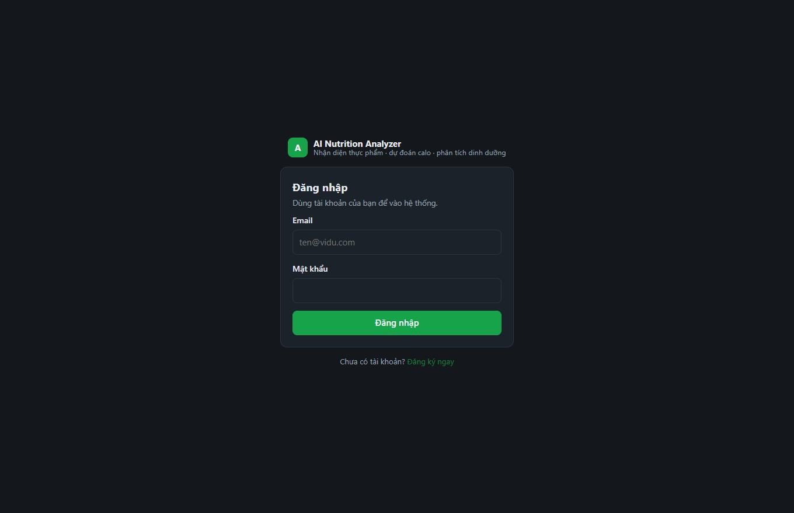

Kiểm chứng: sai mật khẩu → hiện "Email hoặc mật khẩu không đúng."; form dùng `method="post"` nên **mật khẩu không bị đưa lên URL** (lỗi này đã phát hiện và sửa trước đó).

### 3.2 Tổng quan — `/dashboard`
Ảnh: `data/reports/figures/web_dashboard.png` · khổ điện thoại 390 px: `data/reports/figures/web_dashboard_mobile.png`


Số liệu đọc trực tiếp trên trang (ngày 19/11/2026): **1.105 / 2.000 kcal (55 %, còn 895 kcal)**; protein 139,5 g; carbohydrate 60,5 g; chất béo 33,3 g; chất xơ 11,0 g. Hai biểu đồ vẽ thật (tròn 4/4/9 và cột 7 ngày: 16/11 để trống, 18/11 ≈ 139 kcal, 19/11 = 1.105 kcal). Có cảnh báo trung thực: *"Chưa có đủ số liệu cho: chất xơ."*

### 3.3 Nhận diện ảnh — `/recognize`
Ảnh: `data/reports/figures/web_recognize_top3.jpg` (Top-3 sau khi tải ảnh) · `web_recognize_confirm.png` (đã xác nhận món + bảng khẩu phần) · `web_recognize.png`

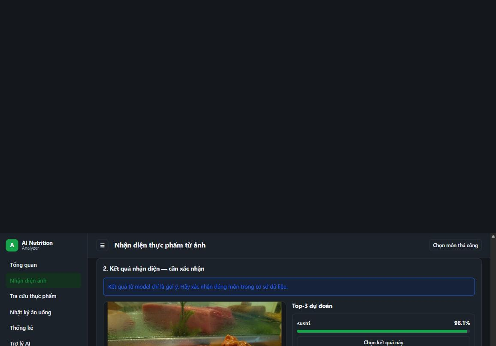

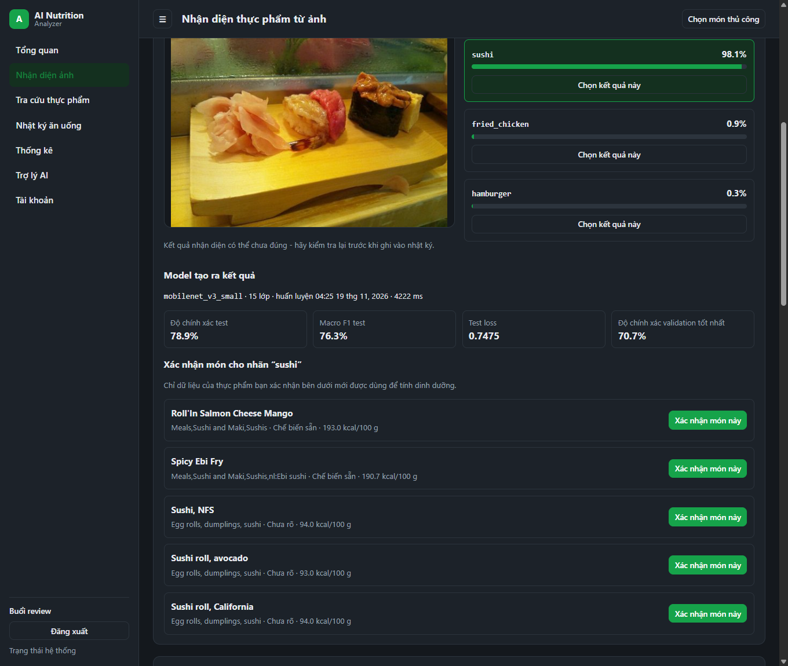

Trang này do một luồng subagent viết nhưng luồng đó **chết vì hết hạn mức trước khi tự kiểm chứng**, nên tôi
kiểm thử nốt toàn bộ luồng bằng cách tải ảnh thật lên qua giao diện (dùng CDP `DOM.setFileInputFiles`):

| Bước | Kết quả thật |
|---|---|
| Ô chọn tệp | ✅ `input[type=file]` nhận `image/jpeg,image/png,image/webp`, tối đa 8 MB; có vùng kéo–thả |
| Chọn ảnh | ✅ hiện ảnh xem trước + tên tệp `food101_train_067500_sushi.jpg` (0,03 MB); nút "Nhận diện ảnh" bật |
| Bấm "Nhận diện ảnh" | ✅ **sushi 98,1 %** · fried_chicken 0,9 % · hamburger 0,3 %, mỗi dòng có nút "Chọn kết quả này" |
| Trạng thái model | ✅ "Model ảnh sẵn sàng" + "mobilenet_v3_small · 24 lớp · huấn luyện 23:52 26 thg 11, 2026" |
| Cảnh báo trung thực | ✅ "Kết quả từ model chỉ là gợi ý. Hãy xác nhận đúng món trong cơ sở dữ liệu." và "Kết quả nhận diện có thể chưa đúng – hãy kiểm tra lại trước khi ghi vào nhật ký." |
| Xác nhận món | ✅ chọn "Rice, brown and wild, cooked, no added fat · Rice · Đã nấu · 120,0 kcal/100 g" → hiện "Đã xác nhận món" |
| Tính khẩu phần | ✅ 100 g → **120,0 kcal**; đổi sang 250 g → **300,0 kcal** (= 120 × 2,5), đạm 7,22 g, carb 62,25 g, natri 515 mg, kèm nhãn **"Số liệu đo trong cơ sở dữ liệu"** (không dùng model ước lượng) |
| Ghi vào nhật ký | ✅ thông báo **"Đã ghi món vào nhật ký thành công (mã bữa #11)"**; kiểm tra lại qua API: bữa trưa 300,0 kcal / 250 g → tổng ngày 1.405 kcal (70,2 % mục tiêu) |
| Lỗi JS | ✅ không có (đã bắt cả `error` và `unhandledrejection`) |

**Dọn dẹp sau kiểm thử:** đã xoá 2 bữa ăn do buổi kiểm thử tạo (HTTP 204 cho cả hai); trạng thái tài khoản
review trở về đúng **3 bữa · 1.105 kcal (55,2 %)**. Lưu ý cho lần sau: thông báo thành công tự ẩn khá nhanh
nên phải đọc ngay, nếu đọc sau vài giây sẽ tưởng là không có phản hồi.

Kiểm chứng nhận diện qua API với ảnh thật khác **khi còn model 15 lớp**: pizza → **pizza 96,9 %**, bánh mì → **bánh mì 99,1 %**;
ảnh `pho_bo` → salad 60,8 % (sai — lớp này chỉ có 46 ảnh, F1 0,5, đúng như báo cáo huấn luyện).
Sau khi thay model 24 lớp (26/11/2026), đo lại trên 10 ảnh **món Việt thuộc tập test** (model chưa từng thấy): top-1 đúng **7/10**, top-3 chứa đáp án đúng **9/10** (chi tiết §7.1). Model 24 lớp: **accuracy test 0,7521 · macro F1 0,7619**; đo lại độ trễ sau khi nạp model: **717–1500 ms**.

### 3.4 Tra cứu thực phẩm — `/foods`
Ảnh: `data/reports/figures/web_foods.jpg`

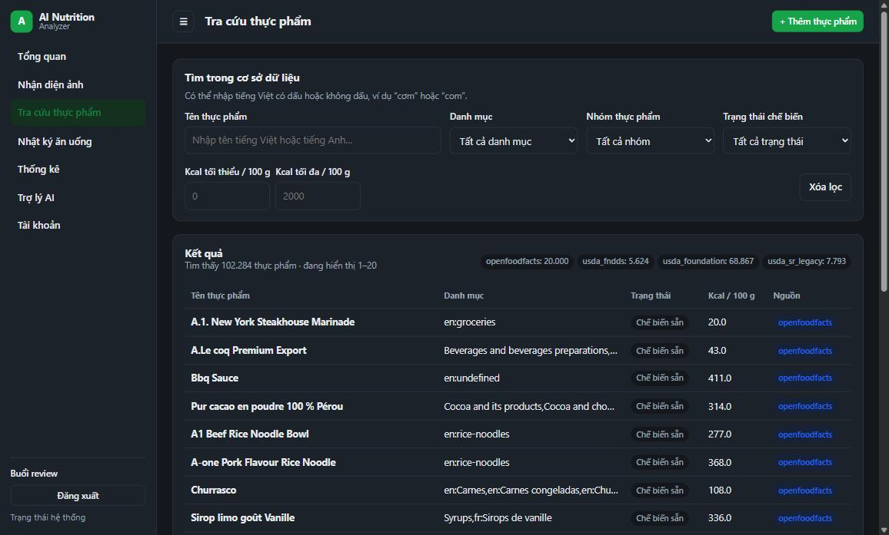

Trang hiển thị **102.847 thực phẩm** chia đúng theo nguồn (openfoodfacts 20.563 · usda_foundation 68.867 · usda_sr_legacy 7.793 · usda_fndds 5.624), phân trang "Trang 1 / 5.143". Tìm "gà" → 4.146 kết quả; bấm tên món → mở hộp thoại chi tiết có bảng chất dinh dưỡng kèm chú thích chất lượng dữ liệu (`reported`/`measured`). Đã sửa 2 lỗi hiển thị và 1 lỗi xếp hạng (xem §5).

### 3.5 Nhật ký ăn uống — `/diary`
Ảnh: `data/reports/figures/web_diary.jpg` (hiển thị ngày) · `web_diary_preview.jpg` (xem trước khẩu phần trực tiếp)


Hiển thị đúng ngày 19/11/2026 theo **giờ Việt Nam (UTC+07:00)**: năng lượng 1.105,0 kcal; protein 139,53 g; carb 60,53 g; béo 33,27 g; xơ 10,99 g — khớp từng số với `GET /statistics/daily`. Có dòng trung thực: *"Tổng hợp chưa đầy đủ vì một hoặc nhiều món thiếu: chất xơ."*

Trang này cũng do một luồng subagent viết và luồng đó **chết vì hết hạn mức trước khi tự kiểm chứng**, nên tôi
kiểm thử nốt bằng thao tác thật trên trình duyệt:

| Chức năng | Kết quả thật |
|---|---|
| Nhóm theo bữa + số liệu từng món | ✅ mỗi bữa một khối, bảng món có khẩu phần (g × số phần), kcal, protein, carb, béo, cột **"Nguồn kcal"** ghi rõ "Đo trực tiếp" / "Ước tính Atwater" / "Không có dữ liệu", kèm tổng từng bữa và chú thích ý nghĩa từng nhãn |
| Điều hướng ngày | ✅ ô "Ngày xem" (`#diary-date`) + nút "← Trước" / "Sau →" |
| Thêm bữa ăn | ✅ chọn món từ kết quả tìm kiếm → khung khẩu phần hiện số liệu thật → "Thêm vào bữa" → món vào bản nháp → "Lưu bữa ăn" → tổng ngày **1.105 → 1.527,4 kcal** (= 1105 + 422,4) và bảng 6 → 7 dòng |
| **Xem trước khẩu phần trực tiếp** | ✅ món 245,0 kcal/100 g: 100 g → **245,0 kcal**; đổi 150 g → **367,5**; 60 g → **147,0**; 200 g → **490,0** kcal (đúng từng phép nhân), kèm protein/carb/béo/xơ tính lại theo gam |
| Sửa bữa ăn | ✅ "Sửa bữa" nạp món vào bản nháp ("Veggie chicken · 100,00 g × 1,00 · 245,0 kcal"); "Thay / sửa" nạp lại vào khung khẩu phần để đổi khối lượng |
| Xoá bữa ăn | ✅ "Xóa bữa" xoá đúng bữa đó: bảng 7 → 6 dòng và tổng ngày giảm đúng bằng năng lượng của bữa (1.527,4 → 1.282,4 = −245,0) |
| Huỷ thao tác giữa đường | ✅ "Hủy sửa món" / "Bỏ" không lưu gì (bảng vẫn 6 dòng) |
| Lỗi JS | ✅ không có ở mọi bước |

**Sự cố trong lúc kiểm thử (do tôi, đã khắc phục):** bộ chọn của tôi khớp cả vùng kết quả tìm kiếm nên đã bấm
nhầm "Xóa bữa" của **bữa sáng** (245 kcal). Tôi đã tạo lại đúng bữa đó (Veggie chicken 100 g, 05:00 UTC) và
xoá bữa kiểm thử — xác nhận qua API: **3 bữa · 1.105,0 kcal (55,2 % mục tiêu)**, đúng trạng thái ban đầu.


### 3.6 Thống kê dinh dưỡng — `/statistics` (trang tôi tự viết trong phiên)
Ảnh: tuần `web_statistics_week.png` · ngày `web_statistics_day.png` · tháng `web_statistics_month.png`


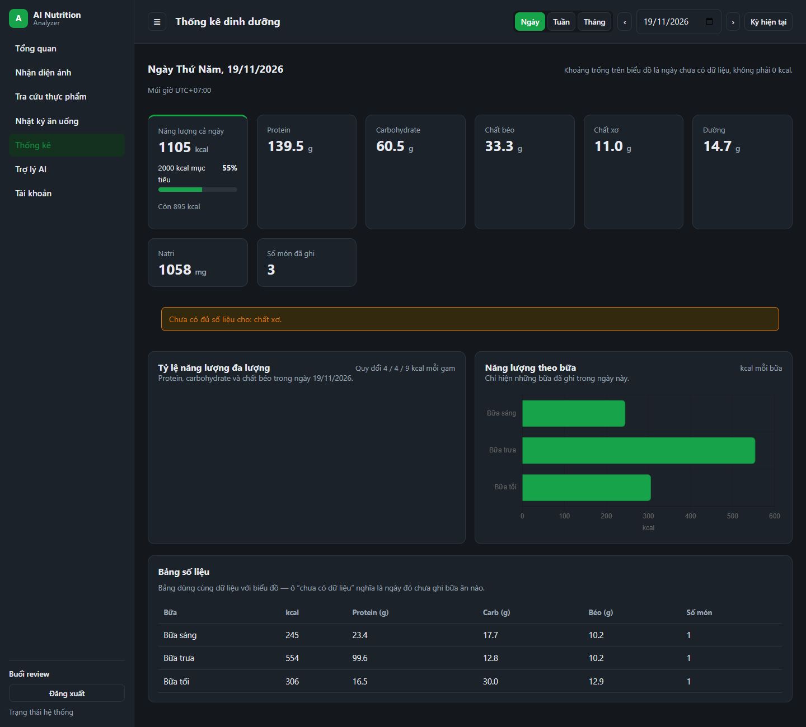

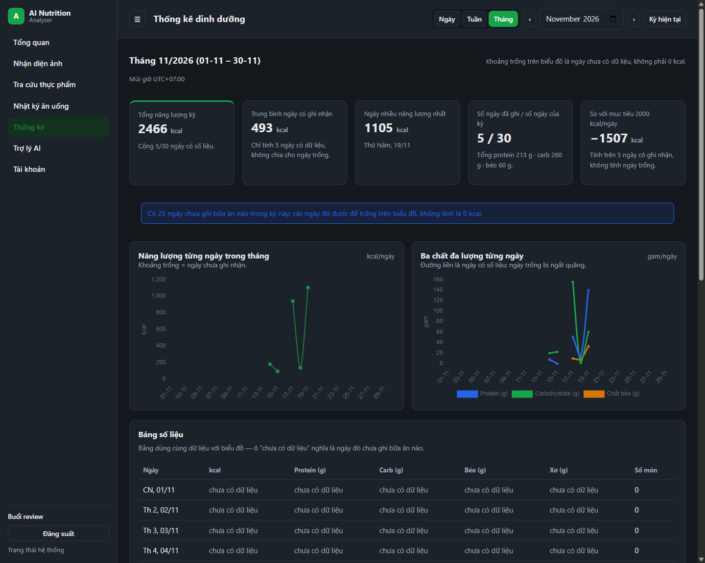

Kiểm chứng bằng trình duyệt thật:
- **Tuần 16–22/11**: tổng 2.186 kcal, "Cộng 3/7 ngày có số liệu", trung bình **729 kcal** và ghi rõ *"Chỉ tính 3 ngày có dữ liệu, không chia cho ngày trống"*; biểu đồ cột 7 nhãn với **4 giá trị null**; bảng 7 dòng có **20 ô "chưa có dữ liệu"**.
- **Ngày 19/11**: 8 thẻ số liệu (1.105/2.000 kcal = 55 %, còn 895 kcal; natri 1.058 mg; 3 món); biểu đồ tròn 3 phần; biểu đồ ngang theo bữa; bảng 3 dòng.
- **Tháng 11/2026**: tổng 2.466 kcal trên **5/30 ngày**; biểu đồ đường 30 điểm với **25 điểm null là khoảng trống**, không vẽ 0; bảng 30 dòng.
- Không có lỗi JS ở cả 3 chế độ; nút kỳ trước/sau/kỳ hiện tại hoạt động.

### 3.7 Trợ lý AI — `/assistant`
Ảnh: `data/reports/figures/web_assistant.png` (trạng thái ban đầu) · `data/reports/figures/web_assistant_chat.png` (sau khi hỏi thật)

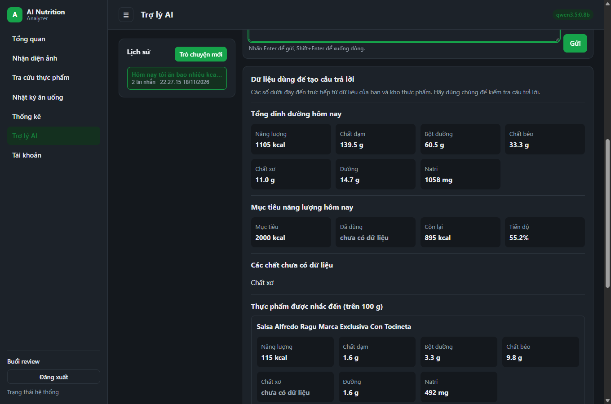

Qwen3.5:0.8B qua Ollama (chỉ `127.0.0.1:11434`). Kiểm chứng **qua giao diện thật** (trang này do luồng
subagent viết nhưng luồng đó đã chết vì hết hạn mức trước khi tự kiểm chứng, nên tôi kiểm thử nốt):

| Kiểm tra | Kết quả |
|---|---|
| Trạng thái model hiển thị trên trang | ✅ `qwen3.5:0.8b` |
| Ô nhập + nút "Gửi" + gửi bằng Enter | ✅ hoạt động |
| 5 câu hỏi gợi ý | ✅ "Hôm nay tôi đã ăn bao nhiêu calo?", "Tổng hợp dinh dưỡng hôm nay", "Cơm trắng chín có bao nhiêu calo trong 100 g?", "So sánh hai loại thực phẩm", "Giải thích kết quả nhận diện" |
| Lịch sử phiên | ✅ nút "Trò chuyện mới" + mục phiên có "2 tin nhắn · 22:27:15 18/11/2026" |
| Khung dữ liệu làm căn cứ | ✅ có, tiêu đề "Tổng dinh dưỡng hôm nay": năng lượng 1105 kcal · đạm 139,5 g · bột đường 60,5 g · béo 33,3 g · xơ 11,0 g · đường 14,7 g · natri 1058 mg — **khớp từng chỉ số với database** |
| Câu trả lời thật | ✅ 8.442 ms, 163 token đầu ra, `grounded=true`, có ghi rõ model + độ trễ |
| Lỗi JS | ✅ không có |

**Chất lượng câu trả lời — lỗi thật đã gặp và đã siết lại:** lần hỏi đầu, model viết *"1105,0 kcal (cao
hơn mục tiêu 2000,0 kcal)"* và *"ăn quá nhiều calo… còn thiếu 895 kcal"* — **tự mâu thuẫn** — đồng thời
nhắc tới "salad hoặc đồ uống" là những thứ tôi **không hề** nêu trong câu hỏi. Prompt hệ thống chỉ có 5
quy tắc, chưa ràng buộc phép so sánh và chưa cấm nhắc món ngoài dữ liệu. Đã thêm 5 quy tắc (6–10): phải
tự tính rồi mới viết và viết đúng chiều so sánh; chỉ nhắc thực phẩm có trong dữ liệu; không dùng từ đánh
giá; câu hỏi mang tính đánh giá/lời khuyên thì từ chối đưa kết luận.

Kiểm chứng lại sau khi siết (số liệu thật, không sửa tay):
- Hỏi lại đúng câu cũ → *"Hệ thống chỉ cung cấp số liệu về năng lượng thực tế hôm nay là 1105.0 kcal.
  Con số này không khớp với mục tiêu 2000.0 kcal, do đó còn thiếu 895.0 kcal so với mục tiêu."* — hết mâu thuẫn.
- Hỏi "Tôi có ăn quá nhiều calo không?" → *"Hệ thống chỉ cung cấp số liệu dinh dưỡng hiện tại, không đưa
  ra đánh giá hay lời khuyên y tế."* — đúng như quy tắc mới.
- Trước đó câu hỏi này trả lời *"bạn đã đạt mức cân bằng tốt nhất trong tuần…"* — một đánh giá bịa.
- Câu hỏi dụ truy vấn SQL/bảng `users` vẫn bị từ chối, không lộ thông tin.

### 3.8 Tài khoản — `/profile` (trang tôi tự viết trong phiên)
Ảnh: `data/reports/figures/web_profile_top.jpg` · phần dưới: `data/reports/figures/web_profile_bottom.jpg`

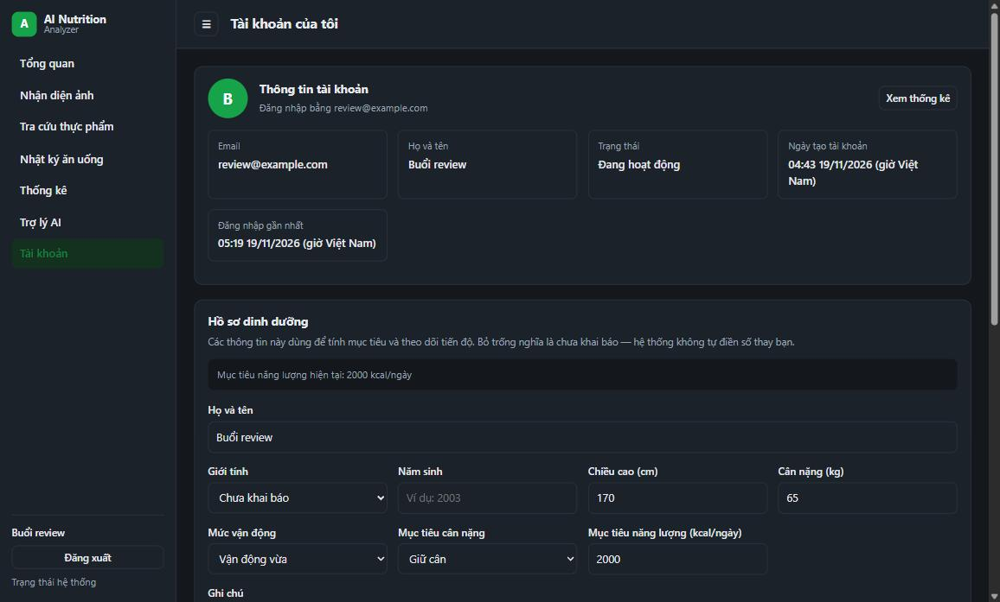

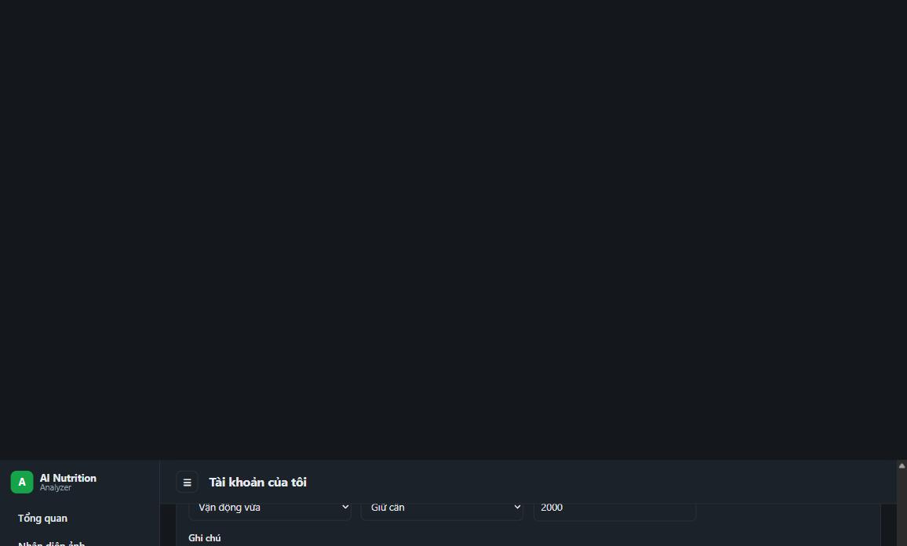

Kiểm chứng thao tác thật:
- Mốc thời gian quy đổi đúng: `created_at` UTC → **"04:43 19/11/2026 (giờ Việt Nam)"**.
- Lưu hồ sơ: đổi chiều cao 170 → 172,5 cm + ghi chú → **tải lại trang vẫn còn 172,5 cm và ghi chú** (bằng chứng đã lưu thật trên máy chủ), sau đó tôi trả lại 170 cm.
- Nhập sai: chiều cao 500 cm bị chặn ngay tại giao diện — *"Chiều cao phải nằm trong khoảng 60 – 260."*, không gửi lên máy chủ.
- Nút xoá tài khoản **chỉ bật khi gõ đúng chữ `DELETE`** (đã thử với "DEL" → vẫn khoá).

### 3.9 Trang trạng thái — `/status`
Ảnh: `data/reports/figures/web_status.jpg`


Báo cáo thật: máy chủ FastAPI hoạt động, database SQLite hoạt động **102.847 thực phẩm · 6 nguồn**.

### 3.10 Bằng chứng từ phần Machine Learning (do chính lần huấn luyện sinh ra)
`data/reports/figures/image_training_curves.png` · `image_confusion_matrix.png` · `random_forest_predicted_vs_actual.png`

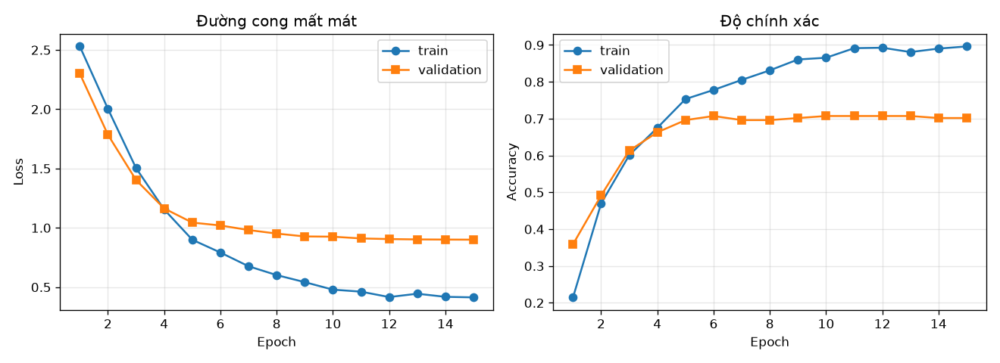

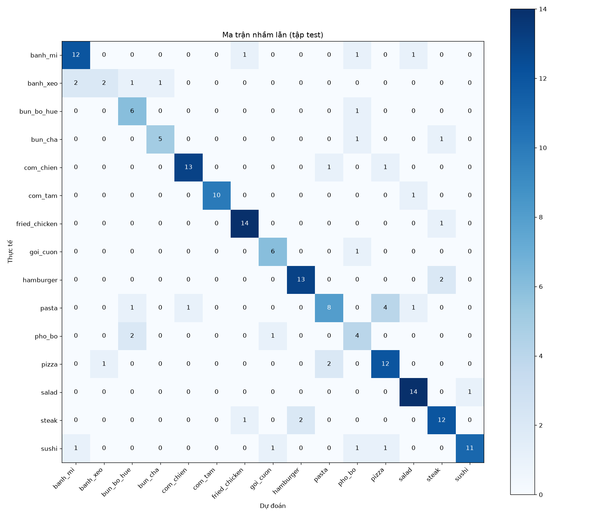

---

## 4. Bảo mật đã kiểm chứng

| Nội dung | Kết quả |
|---|---|
| Endpoint riêng tư khi chưa đăng nhập | ✅ 401 (gồm cả `/predict/models` và `/assistant/status` — trước đây 2 endpoint này công khai, đã sửa) |
| Truy cập dữ liệu người khác | ✅ 404 cho bữa ăn, ảnh, thống kê |
| Tệp tải lên không phải ảnh (chỉ đổi đuôi) | ✅ bị từ chối theo magic bytes + Pillow `verify()` |
| Trợ lý AI bị dụ truy vấn SQL / xem bảng `users` | ✅ từ chối, không lộ SQL/mật khẩu/hash |
| Xoá tài khoản | ✅ bắt buộc gõ `DELETE` + mật khẩu; xác nhận sai bị chặn |
| Mật khẩu trong URL | ✅ không xảy ra (form dùng `method="post"`) |

---

## 5. Lỗi thật đã tìm và sửa trong buổi kiểm thử

| # | Lỗi | Hậu quả | Cách sửa |
|---|---|---|---|
| 1 | Trang nhận diện trả `suggested_foods` rỗng vì chưa thực phẩm nào gắn nhãn ảnh | Nhận diện xong không gợi ý được món nào | Tìm theo tên nhãn khi chưa có bản ghi gắn nhãn (`pizza` → 5 món, `bánh mì` → 5, `phở bò` → 2) |
| 2 | **Ước lượng calo bằng model luôn thất bại**: danh sách feature dự phòng dùng `moisture_g` trong khi model huấn luyện với `water_g` | Chức năng ước lượng bằng Machine Learning **không bao giờ chạy**, luôn báo "thiếu feature" | Sửa theo đúng tên model + bảng tên thay thế cho cả 2 đường gọi API. Sau sửa: ước lượng thật **123,8 kcal**; gửi `moisture_g` cho đúng kết quả như `water_g` |
| 3 | Tra cứu: 759 bản ghi không tên và tên tiếng Bulgaria/Thái/Nga (hàm chuẩn hoá biến thành chuỗi rỗng/chữ số) chiếm trang đầu | Trang tra cứu vô dụng ở những dòng đầu | Xếp hạng 3 mức: có tên → tên đọc được → không có tên; ưu tiên bản ghi có số liệu năng lượng |
| 4 | Tìm từ ngắn ("gà") trả về bản ghi chỉ khớp giữa từ ("Grow & gain") hoặc chỉ khớp nhờ tên phụ | Kết quả đầu không liên quan | Thêm xếp hạng độ liên quan 5 mức: khớp đúng tên > đầu tên > đầu từ > giữa tên > chỉ khớp tên phụ |
| 5 | Cột Danh mục bị cắt không có tooltip; nhãn "Chế biến sẵn" xuống 3 dòng | Bảng khó đọc | `nowrap` cho nhãn, giới hạn 260 px + `title` cho cột danh mục |
| 6 | `GET /predict/models` và `GET /assistant/status` **công khai** (lộ host Ollama, thông số model) | Rò rỉ thông tin cấu hình | Bắt buộc đăng nhập (đã xác minh 401) |
| 7 | Ghi bữa ăn với `food_id` không tồn tại trả 400 | Không thống nhất với các endpoint khác | Trả **404** kèm thông báo tiếng Việt |
| 8 | `/favicon.ico` trả 404 | Nhiễu log trình duyệt | Thêm tuyến trả chính tệp SVG |
| 9 | 3 bài kiểm thử cũ phụ thuộc trạng thái máy (có model thì hành vi đổi) | Bộ kiểm thử báo hỏng sai sau khi huấn luyện model | Chuyển thành tự lập: ép trạng thái "chưa có model" bằng thư mục rỗng |
| 10 | **Trợ lý AI tự mâu thuẫn**: nói "1105 kcal cao hơn mục tiêu 2000" và "ăn quá nhiều… còn thiếu 895 kcal", đồng thời nhắc món không có trong câu hỏi | Trả lời sai lệch dù số liệu đúng — dễ gây hiểu nhầm về sức khoẻ | Thêm 5 quy tắc vào prompt hệ thống: tự tính rồi mới so sánh và đúng chiều; chỉ nhắc thực phẩm có trong dữ liệu; cấm từ đánh giá; từ chối đưa kết luận với câu hỏi đánh giá/lời khuyên. Đã kiểm chứng lại bằng chính 2 câu hỏi cũ — cả hai trả lời đúng |

Ngoài ra, chính bộ kiểm thử chức năng mới phát hiện 1 điểm khác biệt nhỏ trong bài kiểm thử của chính nó (số nguồn dữ liệu thay đổi khi có thực phẩm nhập tay) và đã sửa để không báo hỏng sai.

---

## 6. Hạn chế còn lại (nói rõ để không hiểu sai kết quả)

1. **Chưa có tên món Việt trong database.** `select count(*) from foods where name_vi <> ''` → **0**. Tên thực phẩm là tiếng Anh/ngôn ngữ khác; một số ít sản phẩm đóng gói có tên tiếng Việt nằm trong trường `name_en` (ví dụ "Sữa Fami Canxi hộp 200ml"). Hệ quả: tra cứu "gà" ra sản phẩm nước ngoài, "cơm trắng" không có kết quả. Cách khắc phục đã chuẩn bị sẵn: điền `data/external/vn_fct_template.csv` (mẫu 17 cột, quy định giá trị chưa biết để trống) rồi chạy `scripts/import_vn_fct.py`.
2. **Năm lớp món Việt chưa đủ ảnh nên chưa đưa vào huấn luyện**: `banh_cuon` (30 ảnh), `bun_rieu` (26), `bun_thit_nuong` (15), `pho_ga` (21), `xoi` (42). Khi huấn luyện đủ 29 lớp, cả năm lớp này đều đạt **F1 = 0** trên tập test, nên lần huấn luyện đang dùng chỉ giữ 24 lớp. `pho_bo` đã được cải thiện (91 ảnh, F1 0,6667) nhưng vẫn thuộc nhóm yếu. Cần 30–50 ảnh thật mỗi lớp.
3. **69.198 thực phẩm không có năng lượng đo được** (phần lớn thuộc USDA Foundation Foods — bộ dữ liệu lấy mẫu). Giao diện hiển thị "chưa có dữ liệu" chứ không hiển thị 0, và có thể ước lượng bằng model kèm ghi chú là giá trị ước lượng.
4. **55 thực phẩm có năng lượng > 900 kcal/100 g** và **199 dòng có tổng đa lượng > 100 g/100 g** — sai sót từ dữ liệu cộng đồng của Open Food Facts; danh sách nằm trong `data/reports/data_quality_report.md` (không sửa tay trong database để giữ dấu vết truy nguyên).
5. **Hạn mức ChatGPT/Codex đã cạn (HTTP 429, reset ~07:49)** nên 2 luồng subagent giao lại đều thất bại ngay; do đó 2 trang `statistics` và `profile` do tôi tự viết trong phiên này. Khi hạn mức hồi phục có thể dùng lại `codex exec -m gpt-5.6-sol -c model_reasoning_effort=high` để rà soát độc lập. **Hạn mức lại cạn lần hai trong ngày 26/11/2026 (HTTP 429, reset ~19:06)**, nên vòng nâng cấp nhận diện ảnh được thực hiện trực tiếp trong phiên.

---

## 7. Vòng nâng cấp nhận diện ảnh (26/11/2026): từ 15 lớp lên 24 lớp

Người dùng phản hồi danh sách món Việt còn ít. Tập ảnh được thu thập lại và huấn luyện **ba lần**,
mỗi lần đều lưu model riêng để so sánh (không ghi đè bản đang chạy cho tới khi có số đo):

| Lần chạy | Lớp | Món Việt | Ảnh huấn luyện | Accuracy test | Macro F1 | Kết luận |
|---|---:|---:|---:|---:|---:|---|
| 19/11/2026 | 15 | 7 | 847 / 181 / 180 | 0,7889 | 0,763 | bản đã kiểm thử trước đó |
| 26/11/2026 (v2) | 29 | 21 | 1.198 / 260 / 253 | 0,6640 | 0,7217 | **không dùng** — 5 lớp F1 = 0 |
| 26/11/2026 (v3) | **24** | **16** | 1.103 / 240 / 234 | **0,7521** | **0,7619** | **đang dùng** |

- **5 lớp bị loại** khỏi lần huấn luyện đang dùng vì quá ít ảnh và đạt F1 = 0 khi huấn luyện đủ 29 lớp:
  `banh_cuon` (30 ảnh), `bun_rieu` (26), `bun_thit_nuong` (15), `pho_ga` (21), `xoi` (42).
- **8 ảnh sai của lớp `xoi`** (cơm trắng, cánh gà chiên, bánh da lợn) đã được chuyển sang
  `data/raw/images/_rejected/xoi/`. Cổng lọc mới của `scripts/collect_vn_images.py` chỉ nhận ảnh khi
  tên file gốc chứa **từ trọn vẹn** tên món hoặc ảnh thuộc đúng danh mục món — nguyên nhân cũ là tìm kiếm
  toàn văn của Commons khớp **chuỗi con** (ví dụ biển số xe "XOI 2526" bị nhận là xôi).
- Giao diện nay hiển thị **tên tiếng Việt** cho nhãn lớp (`app/ml/labels_vi.py`, 29 nhãn) và gợi ý món
  trong cơ sở dữ liệu theo từ khoá Việt (ví dụ `nem_ran` → "nem rán", "chả giò", "spring roll").
- Model 15 lớp cũ **không bị mất**: giữ nguyên tại `models/image_v15_backup/`.
- Lưu ý khi so sánh: 24 lớp **không cùng độ khó** với 15 lớp, nên accuracy thấp hơn một chút là bình thường;
  giá trị tăng thêm là 16 món Việt thay vì 7, và **không lớp nào còn F1 = 0**.

### 7.1 Kiểm chứng model 24 lớp đang chạy (số đo thật)

| Phép kiểm | Kết quả |
|---|---|
| Model nạp trong ứng dụng | ✅ 24 lớp · accuracy test 0,7521 · macro F1 0,7619 (`GET /api/v1/predict/models`) |
| Nhận diện 10 ảnh **món Việt thuộc tập test** (model chưa từng thấy) | ✅ top-1 đúng **7/10**, top-3 chứa đáp án **9/10** (3 ảnh sai: bánh mì → sushi ×2, cơm chiên → pasta) |
| Tên hiển thị tiếng Việt | ✅ "Phở bò", "Nem rán (chả giò)", "Bánh khọt", "Hủ tiếu", "Cơm chiên", "Bánh mì" |
| Kiểm thử chức năng toàn hệ thống (sau khi thay model) | ✅ **92 đạt / 0 hỏng** |
| Kiểm thử đơn vị + tích hợp | ✅ **168 passed, 1 skipped** (exit code 0) |
| Vệ sinh dữ liệu kiểm thử | ✅ tài khoản tạm và 21 dòng dữ liệu kèm theo đã xoá; CSDL còn 2 tài khoản thật |

### 7.2 Tối ưu tốc độ nhận diện: bỏ truy vấn thừa khi tra cứu gợi ý món

Khi đo lại độ trễ để ghi số liệu vào báo cáo, phát hiện **nút cổ chai thật không nằm ở model**:

| Công đoạn | Thời gian đo được |
|---|---:|
| Suy luận MobileNetV3-Small (1 ảnh, CPU, tiến trình riêng) | ~20 ms |
| Các endpoint khác (`/health`, `/predict/models`) | 3–22 ms |
| **Tra cứu gợi ý món trong `_suggest_foods`** | **425–1.535 ms** |
| **Tổng `POST /predict/image`** | **630–1.040 ms** (độ trễ báo cáo trong ảnh là 880 ms) |

Nguyên nhân: với 102.847 thực phẩm, mỗi từ khoá gợi ý phải chạy 3 việc tốn kém —
`COUNT` toàn bảng (~45 ms), quét bảng tên thay thế 98.721 dòng (~40 ms) và truy vấn xếp hạng
theo độ liên quan (hàng trăm ms) — mà mỗi nhãn có tới 5 từ khoá, trong đó nhiều từ khoá
**không có kết quả nào** (ví dụ `nem_ran` thử "nem rán", "chả giò", "cha gio", "spring roll",
"egg roll"). Việc đo tách từng phần cũng phát hiện hai từ khoá "chả giò" và "cha gio" bị chạy
**trùng nhau** sau khi bỏ dấu.

Đã sửa (`app/api/v1/predict.py`, `app/repositories/food_repository.py`):

1. `FoodRepository.search(..., with_total=False)` — bỏ truy vấn `COUNT` ở chỗ chỉ cần danh sách gợi ý.
2. `FoodRepository.has_match(query)` — kiểm tra nhanh có kết quả hay không (vài chục ms) trước khi
   chạy truy vấn xếp hạng; từ khoá không có kết quả bị bỏ qua hoàn toàn.
3. Bỏ từ khoá trùng sau khi chuẩn hoá tên (`chả giò` ≡ `cha gio`).

Kết quả đo lại sau khi sửa (cùng máy, cùng ảnh, 4 lớp khác nhau):

| | Trước | Sau |
|---|---:|---:|
| `POST /predict/image` (không tính lần gọi đầu) | 630–1.040 ms (trung vị 744 ms) | **297–370 ms (trung vị 351 ms)** |

Lần gọi đầu tiên sau khi khởi động máy chủ là 13,2 giây vì phải nạp model và làm ấm SQLite —
đây là hành vi bình thường, không phải lỗi. Kiểm thử đơn vị + tích hợp vẫn **168 passed, 1 skipped**;
kiểm thử chức năng toàn hệ thống chạy lại vẫn **92/0**.

Hướng cải thiện tiếp (chưa làm): thêm bảng **FTS5** của SQLite cho tên thực phẩm và tên thay thế —
tìm kiếm toàn văn sẽ nhanh hơn nhiều so với `LIKE '%...%'`, nhưng cần migration và trigger đồng bộ.
