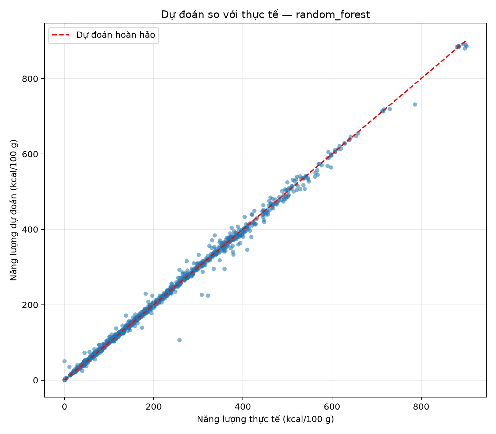

# Thí nghiệm hồi quy năng lượng USDA FoodData Central

- Thời điểm chạy (UTC): `2026-11-18T20:43:53.397207+00:00`
- Lệnh tái lập: `D:/Documents/BaoCao/TriTueNhanTao/AI-Nutrition-Analyzer/.venv/Scripts/python.exe training/regression/run_experiment.py --project-root D:/Documents/BaoCao/TriTueNhanTao/AI-Nutrition-Analyzer`
- `random_state=42` cho tách train/holdout và mô hình; lần tách validation/test dùng `random_state=43`.
- Đơn vị đích: **kcal trên 100 g**.

## 1. Kiểm tra khóa nối USDA

Đếm trên **các `nutrient_id` duy nhất** của từng `food_nutrient.csv`:

| Nguồn | Số ID duy nhất | Khớp `nutrient.id` | Khớp `nutrient.nutrient_nbr` |
|---|---:|---:|---:|
| SR Legacy | 149 | 149 | 0 |
| Foundation | 227 | 226 | 0 |
| Survey/FNDDS | 65 | 0 | 65 |

Kết quả xác nhận SR Legacy và Foundation phải nối `food_nutrient.nutrient_id -> nutrient.id`; Survey/FNDDS phải nối vào `nutrient.nutrient_nbr`. Survey chỉ được dùng để kiểm tra khóa, không đi vào ma trận huấn luyện.

## 2. Dữ liệu, đích và quy tắc loại dòng

| Nguồn | Dòng thực phẩm ứng viên | Giữ lại có Energy 208 | Loại vì thiếu đích 208 | Bản ghi Atwater 957/958 bị loại | Thực phẩm chỉ có Atwater | Bản ghi Energy kJ 268 bị loại khỏi feature |
|---|---:|---:|---:|---:|---:|---:|
| SR Legacy | 7793 | 7793 | 0 | 0 | 0 | 7793 |
| Foundation | 387 | 135 | 252 | 608 | 205 | 135 |

Tổng ma trận cuối: **7928 dòng** ({'SR Legacy': 7793, 'Foundation': 135}). Không nội suy đích. Foundation chỉ lấy `data_type=foundation_food`; SR Legacy lấy `data_type=sr_legacy_food`.

## 3. Kiểm soát rò rỉ đặc trưng

1. Đích chỉ là nutrient `nutrient_nbr=208`, tên `Energy`, đơn vị `KCAL`. Các giá trị Atwater 957/958 không bao giờ được chọn làm đích. Có **608 bản ghi nutrient Atwater** bị loại; **205 thực phẩm chỉ có Atwater** không được đưa vào ma trận. Các thực phẩm vừa có 208 vừa có Atwater vẫn được giữ nhưng chỉ dùng 208.
2. Energy kJ (`nutrient_nbr=268`) bị loại hoàn toàn; không có cột năng lượng hay cột suy ra từ năng lượng trong feature.
3. `fdc_id`, `source`, mô tả gốc và đích không phải feature. Danh sách feature chính xác: `['protein_g', 'fat_g', 'carbohydrate_g', 'fiber_g', 'water_g', 'ash_g', 'food_category', 'cooking_state']`.
4. Tách dữ liệu theo **nhóm mô tả chuẩn hóa** trước khi fit. Một mô tả chuẩn hóa không thể xuất hiện ở nhiều tập. Số nhóm: {'train': 5486, 'validation': 1176, 'test': 1176}. Giao giữa mọi cặp tập đã kiểm tra bằng 0.
5. Median và one-hot encoder chỉ `fit` trên train trong `Pipeline`; validation/test chỉ được `transform`. Chọn mô hình thắng bằng RMSE validation, không dùng test để chọn.

`cooking_state` được suy ra tất định từ từ khóa mô tả: `raw/uncooked` → `raw`; các từ khóa cooked/boiled/baked/broiled/fried/grilled/roasted/steamed/braised/stewed/poached/sauteed/microwaved/toasted → `cooked`; còn lại → `unspecified_or_processed`.

## 4. Thiếu dữ liệu

| Feature | Số giá trị thiếu trước split | Xử lý |
|---|---:|---|
| protein_g | 0 | không cần |
| fat_g | 0 | không cần |
| carbohydrate_g | 0 | không cần |
| fiber_g | 638 | median học từ train (median=0.3000) |
| water_g | 0 | không cần |
| ash_g | 3 | median học từ train (median=1.1500) |
| food_category | 0 | không cần |
| cooking_state | 0 | không cần |

Không loại dòng vì thiếu feature. Chỉ các feature thực sự có thiếu mới bị tác động bởi median; lý do: thiếu bản ghi dinh dưỡng không đồng nghĩa giá trị bằng 0, và median train bền vững hơn mean trước ngoại lệ. Category thiếu được gán nhãn `Unknown`; `cooking_state` luôn có nhãn. Target thiếu bị loại, tuyệt đối không nội suy.

## 5. Chia dữ liệu

- Train: **5552** dòng
- Validation: **1189** dòng
- Test: **1187** dòng

Tỷ lệ đích xấp xỉ 70/15/15; chênh lệch nhỏ có thể xuất hiện do ràng buộc nhóm mô tả.

## 6. Mô hình và kết quả thực chạy

- Baseline: dự đoán trung bình target của train.
- Linear Regression: `fit_intercept=True`.
- Random Forest: 250 cây, `min_samples_leaf=2`, `max_features=1.0`, `n_jobs=-1`, `random_state=42`.
- Gradient Boosting: 250 cây, `learning_rate=0.05`, `max_depth=3`, `min_samples_leaf=3`, `subsample=0.9`, `random_state=42`.

| Mô hình | Tập | MAE (kcal/100 g) | RMSE (kcal/100 g) | R² |
|---|---:|---:|---:|---:|
| Baseline (trung bình tập train) | Train | 131.0843 | 168.2084 | 0.0000 |
| Baseline (trung bình tập train) | Validation | 128.3340 | 166.1604 | -0.0001 |
| Baseline (trung bình tập train) | Test | 135.2988 | 173.5449 | -0.0014 |
| Linear Regression | Train | 5.6015 | 12.4918 | 0.9945 |
| Linear Regression | Validation | 5.7262 | 10.8351 | 0.9957 |
| Linear Regression | Test | 5.3624 | 9.3263 | 0.9971 |
| Random Forest Regressor | Train | 2.5710 | 6.9217 | 0.9983 |
| Random Forest Regressor | Validation | 5.3004 | 10.2175 | 0.9962 |
| Random Forest Regressor | Test | 5.2003 | 10.2751 | 0.9965 |
| Gradient Boosting Regressor | Train | 5.8988 | 10.1656 | 0.9963 |
| Gradient Boosting Regressor | Validation | 6.8579 | 12.3545 | 0.9945 |
| Gradient Boosting Regressor | Test | 6.7506 | 12.5023 | 0.9948 |

Thời gian fit (giây): `{"baseline_mean": 0.964, "linear_regression": 0.0784, "random_forest": 4.79, "gradient_boosting": 4.67}`.

## 7. Diễn giải

Mô hình thắng theo RMSE validation là **Random Forest Regressor**. Trên test, mô hình này đạt MAE **5.2003**, RMSE **10.2751**, R² **0.9965**. So với baseline test, MAE cải thiện **96.16%** và RMSE cải thiện **94.08%**; theo tiêu chí R² dương và RMSE tốt hơn baseline, mô hình **có ích so với baseline**. Đây là đánh giá nội bộ theo FoodData Central, chưa phải kiểm định ngoài miền dữ liệu.

## 8. Phiên bản thư viện

`{"python": "3.12.8", "scikit-learn": "1.9.1", "pandas": "3.1.1", "numpy": "2.5.5", "joblib": "1.6.0", "matplotlib": "3.11.2"}`
